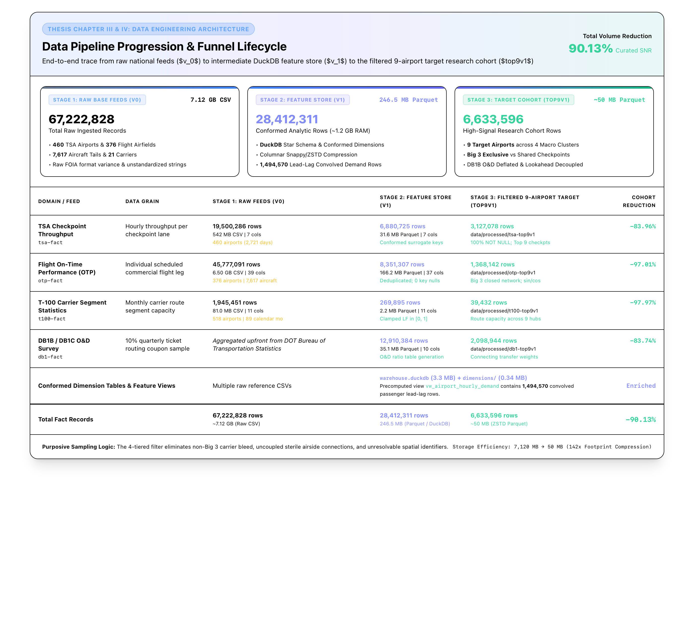

# Chapter I: Introduction

As air travel demand outpaces airport infrastructure growth, inefficient resource allocation has become a critical operational bottleneck (Adacher, Flamini, Guaita & Romano, 2017). Barriers such as prohibitive capital costs and municipal land constraints severely restrict physical terminal expansion (AlKheder et al., 2024; Balliauw & Onghena, 2020; De Neufville & Odoni, 2014; Ozores, 2026). Consequently, airport operators and federal security authorities must extract maximum operational throughput from fixed physical assets through software-driven predictive intelligence.

While predictive models are widely deployed to anticipate terminal demand, the systemic disruptions of the COVID-19 pandemic and subsequent recovery exposed critical vulnerabilities in traditional, accuracy-centric evaluation standards (Sun, Wandelt, & Zhang, 2022). These unprecedented operational disruptions demonstrated that conventional accuracy metrics, while necessary, are insufficient as the sole basis for evaluating models intended for volatile airport operating environments. Specifically, the pandemic revealed that a singular evaluation standard is inadequate across highly variable operational contexts, necessitating the assessment of predictive models through a broader, multidimensional set of performance measures. In airport operations, the most useful predictive model is therefore not necessarily the one with the lowest average forecast error but the model that:

* Robustness (Remains reliable during routine operations): Providing consistent, low-error baseline volatility forecasts during undisturbed flight banks.
* Resilience (Maintains stability and recovers rapidly during disruptions): Absorbing severe exogenous shocks (such as winter freeze events or summer convective ground delay programs) without generating false demand collapses or runaway queue backlogs.
* Generalizability (Transfers effectively across operational contexts): Porting its structural logic across divergent airport terminal layouts and airline hub network topologies without requiring extensive, site-specific historical retraining.
This study examines the suitability of predictive modeling frameworks – spanning deterministic operational baselines (such as persistence and scheduled flight bank dispersion), data-driven decision-tree architectures (automated rule-based machine learning models), and sequential two-stage hybrid models (combining schedule baselines with real-time error correction) – for forecasting Transportation Security Administration (TSA) checkpoint throughput volatility across routine, volatile, and disrupted demand regimes.

## Significance of the Study

This research aims to contribute to airport capacity optimization by shifting the paradigm of how predictive models are evaluated under unpredictable airport operations. By analyzing the relationship between flight operations and TSA throughput, it seeks to assess these frameworks across robustness, resilience, and generalizability, aiming to provide airport management with the strategic flexibility to select forecasting tools tailored to their operational priorities.

## Statement of the Problem

Airport passenger arrivals and behaviors are inherently stochastic, varying significantly by time of day, flight schedules, and external factors (Cheng, Zhang, & Guo, 2012; Dönmez, Tükenmez, & Cecen, 2025). Existing models for managing airport passenger flow tend to rely on static or pre‑pandemic assumptions, often failing to account for unpredictable post‑pandemic travel patterns (Ebert, Dutta, Mengersen, Mira, Ruggeri, & Wu, 2021; Hopfe, Lee & Yu, 2024). This mismatch between capacity planning and fluctuating passenger demand contributes to bottlenecks at check‑in counters, TSA checkpoints, and boarding gates, leading to congestion and inefficient resource allocation. Ultimately, the pandemic demonstrated that static historical baselines are insufficient for modern operations; without an adaptable and dynamic evaluation methodology, airports risk deploying tools that fail to absorb day-to-day demand fluctuations, respond to sudden operational shocks, or account for unique airport characteristics.

## Purpose Statement

The primary objective is to evaluate predictive modeling techniques, such as regression, machine learning, and queuing simulation, to optimize airport capacity via technological rather than physical, more costly interventions. By analyzing the relationship between flight operations and TSA throughput, this study evaluates various predictive modeling frameworks against the primary criteria of robustness, resilience, and generalizability. Rather than seeking a singular, universally optimal model, this research aims to identify which frameworks perform best under each distinct metric.

## Research Question

Which predictive modeling frameworks – spanning deterministic persistence controls, deterministic schedule baselines, machine learning, and sequential two-stage hybrids – are most effective for forecasting airport passenger security screening throughput volatility ($\sigma_{\text{TSA}}$ and $\text{CV}_{\text{TSA}}$) when prioritizing robustness (routine operational accuracy), resilience (stability under convective weather and delay disruptions), or generalizability (cross-airport portability across terminal layouts) as the primary operational evaluation metric?

The Asymmetric Trade-Off ($H_1$): Across the candidate modeling paradigms evaluated, no individual approach will prove superior across all three performance measures (robustness, resilience, and generalizability).

$H_{1\text{a}}$ (Robustness Target: Lowest $\text{RMSE}_{\text{routine}}$ and $\text{MASE}_{\text{routine}} < 0.700$): Supervised machine learning (Model 2) and two-stage dynamic hybrids (Model 3) will successfully achieve the robustness target ($\text{MASE}_{\text{routine}} < 0.700$) under nominal operating conditions, whereas naive persistence (Baseline Control) and deterministic flight schedules (Model 1) will fail this threshold ($\text{MASE} \ge 0.94$).

$H_{1\text{b}}$ (Resilience Target: $R_{\text{RMSE}} \approx 1.00$ [$R_{\text{MASE}} \approx 1.00$], Lowest $\text{MASE}_{\text{shock}}$, and $\text{TTR} < 4.0\text{ hours}$): The Dynamic Two-Stage Hybrid (Model 3) will be the sole architecture to satisfy the resilience target due to recursive 1-step error innovation feedback ($e_{t-1}$). Static supervised machine learning (Model 2) will experience severe performance degradation ($R \ge 2.0$) resulting from the Empty Checkpoint Fallacy during flight ground delays, while deterministic baselines (Model 1) will remain blind to downline delay cascades.

$H_{1\text{c}}$ (Generalizability Target: $\text{RTR} \approx 1.00$ and $\Delta\text{MASE}_{\text{transfer}} \le 10.0\%$): The Deterministic Flight Schedule Model (Model 1) will satisfy the generalizability target ($\text{RTR} \approx 1.00, \Delta\text{MASE} \le 10.0\%$) without local retraining because flight schedule convolution is invariant to local terminal geometry. Conversely, the Dynamic Hybrid (Model 3) will fail the generalizability target ($\text{RTR} \gg 1.00, \Delta\text{MASE} > 10.0\%$) due to decision tree terminal geometry overfitting.

## Delimitations

This study focuses on U.S. airports and uses post-pandemic TSA throughput and flight performance data from 2019 to 2025. It excludes pre-pandemic and pandemic-period activity except where needed to define the post-pandemic baseline. Dynamic queuing models and simulationbased methods are assessed using standard statistical measures, including pvalue, R2 squared, mean squared error (MSE), root mean squared error (RMSE), and mean absolute percentage error (MAPE). A comprehensive operational catalog of research delimitations—including candidate airport selection thresholds, exclusive terminal focus, and the post-pandemic temporal scope—is provided in **Appendix A** (*Delimitations, Research Limitations, and Methodological Assumptions*).

## Limitations and Assumptions

Due to reliance on public data, confidential variables like staffing and manual queue management fall outside the scope of this analysis. While external factors such as weather, regulatory impacts, or IT outages may not be fully accounted for, the framework assumes that utilized data is consistent and findings from the selected airports are generalizable across similar facilities and circumstances. Additionally, the methodology relies on the ability to apply monthly data on load factor to the prediction of TSA throughput on an hourly and seasonal level. Methodological limitations, including unobserved passenger dwell time variability and the absence of linked flight-to-passenger boarding pass records, are formally detailed alongside sensitivity assumptions in **Appendix A** (*Delimitations, Research Limitations, and Methodological Assumptions*).

---

# Chapter II: Review of the Relevant Literature

As commercial aviation navigates a period of sustained traffic expansion that threatens to outpace the physical limitations of existing terminal infrastructure (Federal Aviation Administration [FAA], 2024; International Air Transport Association [IATA], 2026), the prohibitive financial and spatial costs of continuous brick-and-mortar expansion have shifted operational focus toward software-driven, data-informed terminal capacity management (AlKheder et al., 2024; Balliauw & Onghena, 2020; De Neufville & Odoni, 2014; Ozores, 2026). To address these gaps, researchers are developing models designed to optimize resource allocation, such as staffing and throughput management, while maintaining efficient, high-quality service. When passenger demand surges surpass processing capacity at security screening, congestion ripples backward into ticketing halls and forward into departure concourses, inducing boarding holds, tarmac delays, and passenger misconnections across the system (Adacher et al., 2017). Historically, airport passenger flow modeling prioritized statistical fit and mean throughput optimization under static operating assumptions. However, the unprecedented systemic shocks of the COVID-19 pandemic and subsequent recovery demonstrated that models calibrated solely on clear-weather historical data fail during operational disruptions (Sun et al., 2022). Integrating advanced predictive frameworks offers the potential to build the robust, resilient, and generalizable tools necessary to manage variability and balance competing operational demands under uncertainty.

To address these vulnerabilities, this literature review traces the evolution of airport passenger flow prediction across five core theoretical domains: (a) traditional approaches and operational complexity; (b) simulation modeling and real-time terminal management; (c) time-series analysis and machine learning; (d) hybrid predictive architectures; and (e) multi-dimensional operational evaluation, establishing the theoretical foundations for the evaluation trio – Robustness, Resilience, and Generalizability – that governs this research.

## Traditional Approaches and Operational Complexity

Commercial airport terminals are complex operational ecosystems where physical infrastructure, traveler behavior, and airline schedules intersect (Birolini & Jacquillat, 2023; Nazir et al., 2022; Zhang et al., 2012). With domestic passenger demand projected to grow by 2.4% annually while physical airport capacity expands by only 0.8%, commercial aviation faces an operational gap that physical construction cannot resolve due to severe financial, spatial, and environmental constraints (Balliauw & Onghena, 2020; FAA, 2024; Fernandes & Pacheco, 2002; IATA, 2026; Lemer, 1988). Consequently, airport research has shifted away from long-term capital expansion toward dynamic landside operational optimization, utilizing computational models to maximize existing terminal footprints (AlKheder et al., 2024; De Neufville & Odoni, 2014; Solak et al., 2009). Historically, terminal planning relied on deterministic formulas assuming that fixed passenger volumes produce predictable, linear service requirements (Parizi & Braaksma, 1994). In operational reality, however, terminal subsystems – specifically check-in halls, security screening checkpoints, and boarding gates – function as highly interdependent, stochastic queuing networks (Araujo & Repolho, 2015). To maintain a target Level of Service (LOS) – the operational benchmark governing acceptable passenger wait times and crowding thresholds – without prohibitive capital investments, terminal operators must actively identify and eliminate transient bottlenecks that restrict passenger throughput (Di Mascio et al., 2020).

The delicate interdependency of airport subsystems further complicates operational shifts, as localized failures in one segment are particularly vulnerable to time-related constraints, potentially triggering a systemic collapse of flow (Orhan & Orhan, 2020; Bießlich et al., 2014; Brown & Madhavan, 2011). Systemic fragility is exacerbated by the interlocking nature of landside and airside events, where a delay in one sector propagates a cascade of congestion across the entire airport ecosystem (Nazir et al., 2022). Furthermore, congestion does not occur linearly; traffic frequently occurs in high concentrations – "starving" capacity for hours before suddenly "saturating" it in minutes – transforming flow optimization into a moving target that outpaces nominal capacity growth (Chiti et al., 2018). Even when a facility remains under its total daily limits, unexpected arrival fluctuations create "ripples" of upstream congestion, inevitably disrupting downstream processes like security screening (Adacher & Flamini, 2020; Marzuoli et al., 2019). This operational friction is intensified by a persistent temporal lag: a systemic mismatch in which the time required to detect a surge forces additional resources to become available only after the peak has subsided. Ultimately, these bottlenecks are rooted in the unpredictable, stochastic nature of passenger behavior, making resource allocation a complex balancing act between operational costs and quality service levels.

### Batch Arrival Dynamics and Flight Bank Synchronization

Understanding modern airport capacity and the corresponding resource allocation challenge requires looking beyond the simple reality of demand exceeding supply (Fernandes & Pacheco, 2002). A fundamental operational challenge in airport passenger demand forecasting is that passenger arrivals do not follow a uniform, steady stream. Rather, passenger arrivals are characterized by extreme non-linear fluctuations and concentrated "batches" induced by airline flight bank scheduling (Cheng et al., 2012). Modern hub-and-spoke networks intentionally compress 20 to 40 flight departures into synchronized 45-to-90-minute "flight banks" to maximize connecting passenger transfer opportunities (Schultz & Fricke, 2011). When multiple high-capacity aircraft share overlapping departure banks, thousands of ticketed travelers descend on terminal entrances simultaneously, creating non-linear surges that saturate screening lane capacity far more rapidly than smooth arrival streams (Brunetta et al., 1999; Dönmez et al., 2025; Lemer, 1988; Marzuoli et al., 2019). As Peterson et al. (1995) established in their foundational queuing analysis, flight bank synchronization generates transient, non-stationary queuing states where sudden demand bursts produce congestion that persists long after the scheduled bank has departed.

### Classical Queuing Theory: Volume Versus Volatility

To translate unpredictable passenger movements into quantifiable system states, traditional airport planning has utilized Queuing Theory (Horie, 1985; Odoni, 1986). Queuing Theory models how stochastic arrival patterns and concentrated "batches" of passengers interact with various service points throughout the terminal (Wang, 2017). In this framework, every terminal process – from check-in to security screening – is treated as a "server" processing "entities." Early iterations of these models applied a Poisson process distribution to calculate the probability of specific arrival rates within fixed intervals to account for the inherent uncertainty of passenger demand. Poisson arrival distributions (such as M/M/s or M/G/s queuing formulas, which calculate queue lengths and wait times based on assumed random arrival rates and screening speeds) have been used to balance operational staffing costs against target Level of Service benchmarks (Araujo & Repolho, 2015). However, classical Poisson models rest on the assumption of a constant, time-invariant arrival rate ($\lambda$), and consequently consistently struggle to reflect non-linear dynamics and dramatic fluctuations triggered by flight banks (Wang, 2018).

Within an operational context, flight banks act as the primary driver of "batch behavior" in terminal queues (Peterson et al., 1995). Concentration of demand forces the system to process massive, non-linear surges that can saturate capacity far more rapidly than a steady, continuous stream. To address this, researchers transitioned toward Non-Homogeneous Poisson Processes (NHPP) and multiphase networks, allowing arrival rates to vary across sequential service intervals (Brunetta et al., 1999; Hess & Grbčić, 2019). NHPP formulations are constrained due to a dependence on expected mean volume and the assumption of independent arrivals, failing to account for the high correlation among passengers arriving for the same ticketed flight bank and ignoring the impact of airside connecting passengers (Adeke, 2018; Guo et al., 2022). Data-driven queuing models and bottleneck detection algorithms consistently identified passenger security checkpoints as the primary decelerators of overall terminal throughput (Alnowibet et al., 2022; Liu, 2018; Lu et al., 2018; Nikoue et al., 2015). Generalized Stochastic Petri Nets (GSPN) were subsequently applied to reduce "dead time" between screening stages to increase checkpoint service rates (Wei, 2017; Zhang et al., 2017), while likelihood-free inference methods were introduced to better estimate time-varying network flows (Ebert et al., 2021).

### The "Values versus Volatility" Paradigm in Transportation Demand

In operational reality, heavy-traffic queuing principles demonstrate that checkpoint wait times and passenger lines do not depend solely on average passenger volume, but on the irregularity and burstiness of passenger arrivals and processing speeds (Kingman, 1961; Whitt, 1993; see **Appendix C** for complete heavy-traffic queuing derivations, arrival variance formulations, and Kingman approximations). As checkpoint lanes operate near full capacity during morning and evening departure peaks, any sudden increase in passenger arrival swings causes wait times and crowd congestion to grow exponentially (Adeke, 2018; Guo et al., 2022). This dynamic establishes the "Values versus Volatility" paradigm in transportation demand, which manifests across two operational horizons (Andersen & Bollerslev, 1998; Engle, 2001; Hansen & Lunde, 2005). First, over intraday hourly horizons, passenger volume swings naturally expand alongside total flight traffic, allowing scheduled seat counts alone to serve as a dependable baseline predictor for routine daily flow. Second, across multi-day horizons, published flight schedules remain largely unchanged, meaning that anticipating disruption-driven passenger turbulence requires tracking the volatility of operational disruptions – specifically flight cancellations, schedule instability, and departure delay spreads – rather than relying solely on static flight volumes (Hopfe et al., 2024).

## From Analytical Queuing Models to Simulation Modeling and Real-Time Management

### Micro-Simulation in Terminal Planning and Asset Allocation

To overcome the rigid mathematical assumptions of analytical queuing equations, airport planners widely adopted micro-simulation – a modeling approach that simulates individual system entities rather than aggregate flows – primarily implemented through Discrete Event Simulation (DES) (Brown & Madhavan, 2011; Leone & Liu, 2011; Verki et al., 2013). Unlike static spreadsheets, DES models track individual simulated travelers chronologically through discrete physical milestones: ticket verification, divestiture (removing shoes, outer garments, laptops, and liquids for X-ray inspection), body scanning, and item retrieval. By acting as the underlying engine, DES provides the simulation capabilities necessary for a broader Digital Twin framework: a continuously updated virtual replica that mirrors physical infrastructure in real-time (Edwards, 2026). In operational planning, these micro-simulation frameworks proved highly effective for static terminal dimensioning. Guizzi et al. (2009) demonstrated that simulating passenger trajectories from check-in through security screening allowed planners to model queuing interdependencies, while Parlar et al. (2016) used event-based simulations to optimize dynamic counter opening schedules. Furthermore, Nwofia and Chung (2013) highlighted the utility of simulation in linking terminal architectural layouts to long-term service performance, enabling airport authorities to evaluate proposed flight schedules and lane configurations under synthetic operating loads (Araujo & Repolho, 2015; Ateş et al., 2021).

Stochastic planning methodologies (Verki et al., 2013), virtual terminal infrastructure tracking (Edwards, 2026), and simulated human behavioral loads (Perez, 2021) supported asset distribution, while algorithm-based congestion detection (Palaşcă & Stăncel, 2025) recontextualized Poisson queuing within dynamic monitoring frameworks. Additionally, simulation environments such as ARENA (Olusanya et al., 2020; Oprea et al., 2024) and simulation data farming (Patrón et al., 2021) have served as offline synthetic data generators for evaluating security subsystems.

### Operational Limitations of Micro-Simulation

Despite its high fidelity, Discrete Event Simulation (DES) remains constrained by predefined logic structures that create three critical operational hurdles for real-time terminal management: calibration sensitivity, computational latency, and passive behavioral assumptions. Regarding calibration sensitivity, DES models are highly vulnerable to parameter assumptions (Takakuwa & Oyama, 2004); Brown and Madhavan (2011) illustrate this weakness, showing how checkpoint throughput can be disproportionately skewed by baggage alarm rates, as minor fluctuations in human or machine performance significantly distort outputs when the underlying logic cannot adapt. In terms of computational latency, the methodology struggles with the heavy processing intensity required to simulate large traveler populations during rapidly unfolding terminal disruptions, creating a modeling gap that prevents re-running simulations for real-time lane reallocation (Bießlich et al., 2014). Finally, regarding passive behavioral assumptions, Alodhaibi et al. (2017) argue that using a fixed logical sequence treats passengers as passive entities following rigid rules rather than proactive decision-makers who dynamically adjust their arrival timing in response to flight delay alerts. Consequently, the limitations of rule-based fidelity under rapidly changing conditions motivate a transition in the research landscape toward data-driven systems that can actively learn from operational data, rather than merely following static scripts.

## Advanced Predictive Models and Machine Learning

The adoption of Artificial Intelligence (AI) represents the technical realization of this shift through Machine Learning (ML), a subset of AI that moves beyond pre-programmed rules to serve as a pattern-recognition tool capable of managing the stochastic "noise" of passenger behavior (Saki & Soori, 2026). Unlike the rigid nature of early discrete event simulations, these modern architectures serve as the foundation for robust resource allocation by absorbing vast streams of real-time data to forecast emergent behaviors. This evolution represents a fundamental move toward probabilistic reasoning, where the objective is to model the likelihood of various outcomes rather than relying on a single deterministic path.

### Statistical Time-Series Foundations and Linear Limitations

To achieve faster, automated forecasts without the computational latency of micro-simulation, transportation planners turned to empirical time-series models, such as Autoregressive Integrated Moving Average (ARIMA) and Seasonal ARIMA (SARIMA) formulations (Box et al., 2015; Hyndman & Athanasopoulos, 2018; Li et al., 2017). SARIMA models have been used to identify recurring patterns by analyzing the internal properties of a univariate time series, such as the autocorrelation of past arrival waves and daily seasonal cycles. By mathematically 'averaging' its own historical errors and trends, SARIMA effectively captures the predictable rhythms of flight banks and holiday travel (Babu, 2014). However, while SARIMA excels at internal pattern recognition, because it relies on historical data, it does not account for the direct correlation between fluctuating passenger volumes and specific, real-time flight arrangements (Lin et al., 2023).

### Non-Linear Machine Learning: Deep Learning Versus Tree Ensembles

To model complex non-linear relationships that linear statistical models cannot represent, recent aviation literature has explored machine learning algorithms, including deep sequence models such as Long Short-Term Memory (LSTM) recurrent networks, Gated Recurrent Units (GRU), and tree ensembles like Gradient-Boosted Decision Trees (GBM) (Hopfe et al., 2024; Ribeiro et al., 2025). Unlike traditional SARIMA models, LSTMs can learn complex, non-linear long-term dependencies between past arrival waves and future terminal surges, effectively reflecting the external influences that statistical models tend to overlook (Hewamalage et al., 2021). While Orsini et al. (2019) highlight the necessity of the recurrent nature of LSTMs for predicting real-time passenger journeys, the computational demands of such models limit their strategic application. Consequently, dense neural networks provide a computationally efficient alternative for capturing the non-linear surges inherent in airport traffic; a compact, dense architecture achieves high-fidelity forecasting with minimal overhead. Simulation data farming underpins the enhancement of robustness in these predictive tools, offering a pathway to generate the vast datasets necessary for training machine learning models within elaborate security subsystems (Patrón et al., 2021).

### Operational Limitations of Deep Neural Architectures

Despite their theoretical expressiveness, deep neural networks face operational and administrative barriers that prevent their adoption in commercial airport security environments. In a comprehensive spatial transferability study, Wang et al. (2025) demonstrated that deep neural models suffer acute performance collapse—with prediction error inflating by over 40%—when evaluated zero-shot on unfamiliar facilities, precluding multi-airport deployment without costly, site-specific retraining. Even more critically, these models present a “black-box" interpretability barrier: airport security authorities and terminal operations planners operate under stringent administrative, regulatory, and budgetary constraints that preclude committing substantial labor allocations or authorizing high-cost staffing adjustments based on opaque, uninterpretable model weights (Adadi & Berrada, 2018; Viaña et al., 2024). When an algorithm forecasts an unexpected passenger surge, operational leadership requires defensible, rule-based explanations grounded in published flight schedules and upstream airside delays before reallocating critical screening personnel. This demand for transparent inputs becomes even more important as airport operations transition from passive demand forecasting toward active behavioral modeling and real-time control frameworks.

### From Passive Prediction to Behavioral Modeling and Active Control

Recognizing the limits of passive flow prediction, recent transportation literature has explored active control frameworks where predictive models inform real-time operational decisions. Multi-agent reinforcement learning has been utilized to model proactive passenger navigation under terminal constraints (Li & Gao, 2023), although Anagnostopoulou et al. (2024) documented persistent functional gaps in capturing actual flow volumes. To bridge the gap between prediction and tactical intervention, Diaz-Gutierrez et al. (2025) developed Model Predictive Control (MPC) algorithms that integrate stochastic terminal dynamics into automated resource optimization loops. Concurrently, Lee et al. (2025) and Yang et al. (2022) formulated dynamic passenger guidance and rescheduling strategies to balance crowding across parallel departure checkpoints in real time. These active control formulations demonstrate that high-utility forecasting tools must provide transparent, actionable inputs that align directly with operational decision rules.

### Hybrid Architectures: Combining Operational Structure with Data-Driven Adaptability

To resolve the "black-box" challenge – where the internal logic of deep learning models is difficult to interpret – researchers increasingly advocate for hybrid architectures that couple data-driven prediction with physical constraints (Adadi & Berrada, 2018; Jenčová et al., 2025). In early hybrid formulations, neural network flow forecasts are passed to secondary optimization layers – such as Simulated Annealing or Integer Linear Programming (ILP) – to enforce checkpoint throughput limits and determine staffing buffers (Brun et al., 2025). Similarly, combining Random Forest predictions with deterministic queue-length models translates broad passenger volumes into actionable, flight-level wait-time insights (Had et al., 2025).

To improve predictive stability across varying conditions, recent research integrates deep learning with exogenous covariates and queuing dynamics. Hopfe et al. (2024) demonstrated that combining Gated Recurrent Units (GRU) with gradient boosting improves forecast accuracy by incorporating external variables, such as weather and mobile search behavior. Similarly, Ribeiro et al. (2025) showed that embedding queuing-theoretic features directly into Gradient Boosting Machines (GBM) captures non-linear congestion dynamics far better than unassisted models. To capture multi-scale patterns, the Fusion Intelligence Network Model (FINM) proposed by He et al. (2024) combines Convolutional Neural Networks (CNN) for spatial feature extraction, Bidirectional LSTMs (BiLSTM) for temporal context, and GRUs for computational efficiency, maintaining stability under rapidly shifting terminal traffic.

Despite their predictive power, multi-layered networks lack transparency, presenting a major barrier for airport operators who must understand the causal mechanism behind unexpected passenger surges (Viaña et al., 2024; Wang et al., 2025). To achieve causal interpretability, "glass-box" Bayesian Networks (BNs) represent probabilistic dependencies through explicit cause-and-effect structures. Guo et al. (2025) extended this framework by coupling Bayesian Networks with the Best-Worst Method, quantifying interdependencies among terminal resilience factors to capture both physical facility constraints and human variability. Similarly, Hybrid Queue-based Bayesian Networks (HQBN) blend classical queuing theory with probabilistic reasoning to diagnose the root causes of congestion across sequential screening stages, enabling explainable decision-making for tactical resource allocation (Wu et al., 2014).

Managing operational uncertainty further requires stochastic optimization and empirical validation. Metaheuristic algorithms, particularly Particle Swarm Optimization with Back Propagation (PSO-BP), tune neural network parameters without exhaustive search, improving performance on non-linear baggage flows and screening wait times (Jiang et al., 2024; Naji et al., 2020; Sörensen, 2015; Wu, 2024). Under noisy operational data, likelihood-free inference estimates system dynamics during unpredictable disruptions (Ebert et al., 2021), while Nonlinear Autoregressive with Exogenous Input (NARX) models incorporate weather covariates to improve forecast transparency (Anupam & Lawal, 2024). These predictive components are commonly benchmarked within simulation platforms like ARENA to validate physical queue behavior (Olusanya et al., 2020; Oprea et al., 2024). Furthermore, Fuzzy Logic systems model subjective passenger decision-making under uncertainty, enabling real-time terminal routing toward underutilized checkpoints (Blasco-Puyuelo et al., 2023; Xia et al., 2020; Yang et al., 2022). Ultimately, because complex models often trade interpretability for statistical fit, operational deployment necessitates architectures that balance predictive accuracy with transparency (Wu et al., 2024).

In airport security screening, achieving this balance requires anchoring models in deterministic flight schedules rather than unconstrained time series. Grounded in Airport Cooperative Research Program (ACRP) Report 40, passenger arrival distributions follow an empirical lognormal curve peaking 90 to 120 minutes prior to domestic departures (Transportation Research Board [TRB], 2010). To prevent severe demand distortion at hub airports, published schedules must be filtered using empirical connecting ticket ratios from Bureau of Transportation Statistics (BTS) DB1B surveys, excluding airside transfers who bypass landside checkpoints (Guo et al., 2022). During operational disruptions—such as flight delays and cancellations—supervised tree ensembles (Gradient-Boosted Decision Trees or Random Forests) predict the residual error between scheduled demand and actual throughput (Brun et al., 2025; Hopfe et al., 2024; Ribeiro et al., 2025). Decision trees provide intuitive, auditable branching rules that terminal managers can inspect during severe weather events. Finally, during catastrophic ground stops where static schedules collapse and falsely predict zero demand (the "Empty Checkpoint Fallacy"), incorporating recursive real-time error feedback allows models to monitor live checkpoint sensors and dynamically update queue states, ensuring rapid recovery (Anupam & Lawal, 2024; Ebert et al., 2021; Wu et al., 2024; see **Appendix B** for the complete comparative modeling paradigm taxonomy and peer-reviewed equation registry).

## The Impact of Post-Pandemic Operational Volatility

While predictive modeling for airport passenger flow utilizes probabilistic methods capable of processing both pre-pandemic and pandemic data, the unprecedented operational shocks of COVID-19 revealed a critical vulnerability in how these models are evaluated (Sun et al., 2022). Existing frameworks proved ill-equipped to account for extreme, abrupt disruptions in the commercial air traffic industry. The pandemic fundamentally altered terminal operations as airports were driven to restructure passenger handling, shifting priorities away from speed-centric throughput toward the minimization of public health risks (Mota et al., 2021). As even highly sophisticated models struggled to accurately forecast flow amidst these profound spatial and procedural changes, it became evident that raw predictive accuracy could no longer serve as the sole benchmark for a model's efficacy (Li et al., 2023). Consequently, the systemic disruptions of COVID-19 drove a paradigm shift in airport passenger flow operations, prioritizing robustness, resilience, and generalizability as primary evaluation criteria.

### Robustness to Procedural Volatility (Performance Under Perturbation)

The rapid adoption of digital and self-service processes initially introduced highly volatile processing times, transforming automation from a reliable accelerator into a potential operational bottleneck (Lin, 2022). Consequently, predictive models must now be evaluated on their robustness—their capacity to adapt to sudden shifts and treat these dynamic, unpredictable processing times as active variables rather than stable baselines.

### Resilience to Systemic Shocks (Capacity to Absorb and Recover from Disruption)

Terminals witnessed the emergence of decentralized queue structures, physical barriers, and curtailed staffing levels to align with diminished and unpredictable passenger demand (Schultz et al., 2021; Kazda et al., 2022). This structural upheaval necessitates an emphasis on resilience, ensuring models can withstand severe systemic shocks and accurately map extreme demand fluctuations alongside sudden physical capacity constraints.

### Generalizability Across Environments (External Validity)

The pandemic revealed that ostensibly "similar" airports harbored drastically different underlying structural vulnerabilities, demonstrating that comparable variables could not uniformly explain the volatility of passenger flow across different hubs (Güner & Seçkin Codal, 2024). Moreover, confounding factors - such as simultaneous capacity-altering construction at specific airports or industry-wide shifts in flight schedules - proved that evaluating raw throughput without contextualizing infrastructure changes leads to flawed assumptions. As a result, models must be highly generalizable across structurally diverse terminal environments to effectively decouple the relationship between flight schedules and actual operational throughput (Tang et al., 2023).

Crucially, this three-dimensional evaluation framework reveals inherent operational trade-offs (H1 - Master Asymmetric Trade-Off Hypothesis): no single forecasting paradigm universally dominates all three operational dimensions. A model engineered to maximize routine accuracy (Robustness) may collapse during severe weather shocks (Resilience), while a complex architecture tuned to absorb disruption may overfit to local terminal geometry and fail zero-shot spatial deployment (Generalizability). The lessons of the pandemic underscore that a model's utility is no longer defined merely by its baseline accuracy, but by its capacity to adapt to structural and procedural volatility. Integrating robustness, resilience, and generalizability into future predictive frameworks is therefore not just an enhancement, but an operational necessity. Only by embracing these criteria can the industry develop adaptive systems capable of navigating the complex, unpredictable realities of modern terminal environments.

---

# Chapter III: Methodology

This chapter details the approach and analytical framework to evaluate and optimize passenger flow forecasting, specifically at airport security checkpoints. To provide a structural roadmap for this investigation, the methodology is organized into five components:

* Research Approach: Establishes the theoretical framework, research variables, hypotheses, experimental design, and the technical apparatus utilized.
* Sample: Outlines the multi-tiered macro and micro sampling frameworks used to categorize physical checkpoint environments and terminal architectures.
* Sources of Data: Identifies the primary authorized data repositories supplying the longitudinal datasets.
* Validity: Addresses and controls internal and construct threats, specifically related to passenger flow bias and screening lane heterogeneity.
* Treatment of Data: Details the sequential pipeline used to ingest, clean, standardize, and align the data sources.

## Research Approach

The study uses an exploratory, sequential, quantitative design to systematically assess the predictive accuracy and operational utility of distinct forecasting approaches for passenger flow forecasting at airport security checkpoints. While this study evaluates a broad range of frameworks – including static deterministic baselines – it asserts that to truly optimize checkpoint flows, terminal subsystems (i.e., check-in, security screening, and boarding) must ultimately be treated as a stochastic queuing network capable of absorbing dynamic, schedule-driven variability (De Neufville & Odoni, 2014). The primary objective is a comparison of three model families (Figure 1): deterministic baselines, probabilistic and data-driven models, and hybrid frameworks. Deterministic baselines serve as reference cases based on historical averages and scheduled operations. Probabilistic and data-driven models include methods such as SARIMA, LSTM, and random forest models that are designed to capture temporal variation. Hybrid frameworks combine queueing theory with exogenous operational data to reflect both system structure and observed schedule effects.

The predictive capabilities of each model configuration focus on three core performance measures: robustness, resilience, and generalizability. In this investigation:

Robustness: Consistency and precision under nominal on-time operating conditions and routine daily operations.

Resilience: Stability, error boundedness, and speed of recovery after severe exogenous operational disruptions.

Generalizability: Performance across different airports or terminal layouts under zero-shot spatial transfer without local retraining.

### Core Research Variables

Independent Variables: Scheduled flight departures, actual flight performance data (departure delays, taxi-out queues, tactical cancellations), terminal structure categories, and origin-and-destination passenger ratios. Dependent variables include TSA checkpoint throughput, queue wait times, and bottleneck formation rates. Comparative predictive model performance across the candidate models will serve as a secondary outcome.

### Research Hypothesis

Core Research Hypothesis (H1 – Master Asymmetric Trade-Off Hypothesis). Across the candidate modeling paradigms evaluated following four-tiered purposive filtering (deterministic flight schedules, supervised machine learning, and dynamic two-stage hybrid), no individual approach will prove superior across all three performance measures (robustness, resilience, and generalizability); rather, each modeling paradigm exhibits distinct operational strengths and stark asymmetric trade-offs:

Robustness Performance: Under nominal operating conditions (departure delays $< 15$ minutes, zero cancellations), machine learning and dynamic hybrid models achieve target robustness ($\text{MASE} < 0.700$), with machine learning delivering a computationally lightweight, Pareto-efficient routine solution with zero feedback compute latency.

Resilience Performance: Under severe operational disruptions (departure delays $\ge 45$ minutes or cancellations $\ge 5$), the dynamic two-stage hybrid model demonstrates superior resilience ($R_{\text{MASE}} \approx 1.00$, $\text{TTR} < 4.0\text{ h}$) by utilizing live floor error feedback to track stranded passenger crowds, whereas pure machine learning collapses due to the Empty Checkpoint Fallacy.

Generalizability Performance: Under zero-shot cross-airport transfer without local retraining, the deterministic flight schedule model achieves superior generalizability ($\text{RTR} \approx 1.00$, $\Delta\text{MASE} \le 10.0\%$) due to terminal geometry invariance, whereas hybrid models experience transfer penalties from terminal layout overfitting.

Formal hypothesis formulations, econometric evaluation thresholds, and Diebold-Mariano forecast accuracy test specifications are compiled in **Appendix G** (*Statistical Significance Testing*) and **Appendix J** (*Candidate Predictive Models and Evaluation Metrics*).

### Design and Procedures

This investigation follows an exploratory, quantitative, non-experimental design executed across four sequential phases:

Phase 1: Ingestion and Harmonization (ETL): Compiling, cleansing, and relationally joining multi-source federal datasets spanning 2019 to 2025 across common spatial and temporal dimensions.

Phase 2: Model Configuration and Training: Calibrating the candidate modeling suite—the Baseline Control (daily persistence), Model 1 (Deterministic Flight Schedule Model), Model 2 (Supervised Machine Learning Model), and Model 3 (Dynamic Two-Stage Hybrid Model)—across the post-pandemic development partition.

Phase 3: Out-of-Time Holdout Execution: Benchmarking all candidate models against the untouched full-year 2025 holdout dataset under nominal, routine, and disrupted operational regimes.

Phase 4: Comparative Evaluation and Strategic Synthesis: Assessing models across the evaluation triad to determine asymmetric trade-offs, evaluating the Values versus Volatility paradigm, and formulating an operational decision playbook.

Figure 3  
*Design and Procedure Phases*

*Note.* High-Performance Computing (HPC) sequential extract, transform, and load pipeline coupling TSA FOIA throughput records with BTS operational datasets.

### Apparatus and Materials

To manage, parse, and evaluate the large datasets required for this study, the following software and computing resources are used:

Google Antigravity & Python Analytics Stack: The primary computational environment for automated data ingestion, spatial key resolution, relational joins, and machine learning model training.

Persistent Cloud Data Warehouse: Secure, version-controlled cloud storage maintaining complete conformed master datasets, relational lookup dimensions, and audit logs to ensure scientific reproducibility.

Microsoft Excel for Mac & Microsoft Power BI: Deployed locally for advanced data transformation, tabular synthesis, and visual validation.

## Sample

The sample consists of airport checkpoint environments selected to reflect variation in terminal structure and airline dominance. Airports are grouped into structured categories to account for how physical layout influences passenger distribution and checkpoint use (OAG, 2026). This strategy is intended to support comparison across terminal types and carriers rather than to claim complete uniformity across airports and airlines.

### Macro Categorization: Terminal-to-Airline Distribution

Airports are first classified into four structural archetypes to control for how airline market share impacts terminal distribution, with structural archetypes outlined below:

Mega Hubs with No Dedicated Terminals (e.g., ATL, CLT, DEN): Sprawling operations where major legacy carriers share linear concourses or central ticketing, distributing passenger volume across shared screening areas.

Decentralized Airline-Dedicated Terminals (e.g., LAX): Dispersed multi-terminal airports where distinct physical buildings are allocated exclusively to individual legacy carriers, isolating an airline's passenger wave to specific physical checkpoints.

Single-Carrier Dedicated Mega-Terminals (e.g., DTW): Single-carrier "fortress" environments where a single dominant airline channels its entire domestic and international operation through one massive mega-terminal (e.g., Delta’s exclusive hold on the McNamara Terminal).

Airports with Multiple Terminals Dedicated Exclusively to One Airline (e.g., DFW): Large-scale regional hubs requiring a single dominant carrier to distribute hub-and-spoke operations across multiple independent terminal buildings (e.g., American Airlines utilizing Terminals A, B, C, and E) to scale its operations.

### Micro-Level Refinement: Checkpoint Co-Location and Isolation

While macro terminal assignments establish an operational baseline, localized checkpoint-level configurations ultimately determine queue characteristics. American Airlines, Delta Air Lines, and United Airlines are selected for analysis. The explicit criterion for inclusion is a domestic enplanement market share exceeding 10% at major United States hub airports (BTS, 2026). Recent reporting suggests Southwest’s boarding and carry-on system is both distinctive and inconsistent: the airline still relies on a differentiated low-fare brand, but its newer assigned-seating and baggage-fee policies have increased carry-on pressure and created boarding congestion (Boston 25 News, 2026). To isolate the effects of low-cost carriers and unaligned traffic from legacy airline operations, the following terminal and checkpoint characteristics are defined to account for the impact of extenuating variables:

Shared Checkpoints with Limited Carrier-Level Separation (Centralized): In centralized hub models like Salt Lake City (SLC), a dominant carrier may hold the majority market share (70%), but a single consolidated terminal channels 100% of passengers through one primary security checkpoint. In these environments, it is not readily possible to isolate carrier-specific passenger flows using the available data structures.

Isolated Checkpoints (Decentralized): To find checkpoints highly unlikely to see Delta, American, or United traffic, the methodology prioritizes decentralized layouts with extreme carrier polarization, such as the following:

DCA (Terminal 1): Consisting of Gates A1–A9, this terminal exclusively serves Air Canada, Frontier, and Southwest. American, Delta, and United are completely segregated into Terminal 2, creating a strong comparison setting for low-cost and regional carrier processing behaviors.

SEA (Decentralized Main Terminal): Utilizing five separate security checkpoints across a footprint dominated by Alaska Airlines (52% market share). Checkpoints feeding Alaska-heavy gates or dedicated satellite concourses offer a high statistical probability of isolating non-Big Three passenger flows.

CLT (Extreme Dominance Isolation): Where American Airlines controls 90% of the market share. Because Delta (2.5%) and United (2%) maintain a negligible footprint across the airport's 5 checkpoints, nearly any selected lane acts as a functional monoculture for a single legacy carrier's hub behavior.

### Four-Tiered Purposive Filtering Pipeline

To systematically isolate the direct operational link connecting airside flight schedules to landside security checkpoint demand, candidate airfields were filtered through a four-tiered purposive funnel:

Tier 1: Macro Filter (Scale and Congestion Regimes). The macro filter restricts the initial sampling universe to high-volume commercial airfields where heavy passenger traffic intensity routinely approaches screening capacity, generating the non-linear queuing delays and buffer depletion necessary to train and validate congestion-aware models.

Tier 2: Meso Filter (Airspace Shock Invariance). The meso filter requires candidate environments to operate concurrent domestic mainline services by American Airlines, Delta Air Lines, and United Airlines under identical regional meteorological and air traffic management conditions, neutralizing exogenous airspace disruption confounders while excluding low-cost carrier churn.

Tier 3: Micro Filter (Carrier Checkpoint Isolation). The micro filter restricts analysis to terminal environments where carrier-exclusive gate footprints map directly to dedicated security screening checkpoints, eliminating inter-carrier schedule collinearity and multi-airline passenger crosstalk.

Tier 4: Factorial Cohort (Orthogonal Factorial Balance). The factorial cohort establishes a balanced experimental matrix across the legacy carriers and terminal structural archetypes, ensuring factorial symmetry and preventing geographic or facility-specific bias in cross-airport model evaluations.

### Temporal Scope and Boundary Definition

To ensure structural modeling integrity, the temporal boundaries of this sample exclude the systemic operational volatility induced by the COVID-19 pandemic (Sun et al., 2021; Gao, 2022). While a baseline 'post-pandemic' operational era is provisionally considered as beginning January 1, 2023, an exploratory analysis is performed during data preprocessing to refine this demarcation due to varying definitions of ‘post-pandemic’ (ICAO, 2024; Centre for Aviation, 2025). This preprocessing step evaluates pre-pandemic baseline patterns against longitudinal 2019–2025 data to pinpoint the empirical inflection point where system throughput and schedule deviations returned to steady-state normalization. Structural break tests, rolling Welch's $t$-tests, and CUSUM analyses identified May 1, 2022 as the empirical inflection point, coinciding with the vacatur of the federal transit mask mandate and the rebound of airline load factors to 84.7%, matching pre-pandemic baselines. Restricting the active dataset to this verified window enables the forecasting models to capture contemporary queue dynamics and schedule-driven variability without being skewed by transient historic anomalies.

## Sources of Data

Secondary operational data are compiled from four primary authorized federal repositories covering the longitudinal study period: Transportation Security Administration (TSA) Freedom of Information Act (FOIA) Security Screening Checkpoint Logs, Bureau of Transportation Statistics (BTS) On-Time Flight Performance records, BTS Form 41 Schedule T-100 Domestic Segment Data, and BTS Origin and Destination Ticket Surveys (DB1B). Together, these longitudinal feeds capture hourly physical screening counts across checkpoint lanes, individual domestic flight movements and delay cause decompositions, aircraft seating configurations and route load factors, and quarterly passenger itinerary connection ratios. Complete repository profiles, entity grains, and operational attributes are detailed in Table A.3 and the Appendix.

## Validity

A major threat to internal model validity is the presence of connecting passengers who remain airside and do not pass through a public checkpoint in load factor data. Including them in checkpoint demand estimates inflates predicted originating demand. To reduce this bias, origin-and-destination data is used to estimate and remove connecting traffic from passenger flow calculations. Construct validity is also affected by checkpoint heterogeneity, as the raw lane counts obtained from TSA Throughput data combine different screening modes, such as TSA PreCheck, and their corresponding processing rates.

## Treatment of the Data

Data processing follows a sequential pipeline. First, raw BTS and TSA files are exported and parsed using Python on the institutional computing environment. Timestamps are standardized to a uniform operational clock matching local airport solar time. Scheduled overnight checkpoint closures are preserved as true operational structural zeros, and advance cancellations are separated from tactical cancellations to preserve information causality. Lastly, flight departure times are aligned with passenger lead-time assumptions from ACRP Report 40 and merged with hourly TSA throughput intervals to create a final modeling dataset, with the complete High-Performance Computing (HPC) data cleansing, dimension conformation, and relational alignment protocol detailed in **Appendix F** (*Multi-Source Aviation Data Feeds, ETL Architecture, and Data Hygiene Protocols*).

---

# Chapter IV: Findings and Discussion

This chapter presents the empirical findings and comparative performance evaluations for modeling throughput volatility at commercial airport passenger security checkpoints. Using a conformed multi-source dataset spanning seven calendar years (January 1, 2019 to December 31, 2025) across the Top 25 United States commercial airports, this research investigates how published flight schedules and real-time operational flight disruption metrics interact with passenger screening arrival dynamics. To systematically present and discuss these results, this chapter is organized into four core sections:

* **Initial Exploratory Data Analysis: Establishes the post-ETL multi-source data foundation, identifies the post-pandemic structural equilibrium demarcation point (May 1, 2022), characterizes macro annual and day-of-week seasonality, and uncovers the fundamental econometric decoupling between raw flight departures and checkpoint volumes.**
* **Data Filtering and Subset Selection: Details the four-phase purposive filtering pipeline that isolates a balanced nine-airport experimental cohort representing 12 carrier-exclusive screening environments, provides comparative descriptive statistics, validates carrier isolation econometrically, and establishes four mandatory architectural requirements for airport passenger flow modeling.**
* **Model Development and Execution: Documents feature engineering over empirical lead-lag transfer dynamics, introduces the candidate modeling architectures, establishes the dataset partitioning and calibration scale in a structured matrix, and defines the evaluation protocol on the untouched 2025 full-year out-of-time holdout dataset.**
* **Model Results and Evaluation: Evaluates model performance across the governing evaluation triad (Robustness, Resilience, and Generalizability), formally tests the thesis hypothesis using a streamlined multi-pillar evaluation matrix, and confirms the asymmetric performance trade-offs across operational paradigms.**
* **Initial Exploratory Data AnalysisDescriptive StatisticsTemporal BaselinesDefining SeasonalityOTP & TSA Throughput dataImplications for Data SubsetData Filtering and Subset Selection4 Phase Filtering PipelinePipeline ResultsDescriptive Statistics for Data SubsetImplications for Model SelectionModel development and executionFeature EngineeringModel TrainingModel TestingImplications for Results InterpretationModel Results and EvaluationModel ResultsGeneral Model PerformanceHypothesis TestingReal-World ApplicationInitial Exploratory Data AnalysisDescriptive StatisticsTemporal BaselinesDefining SeasonalityOTP & TSA Throughput dataImplications for Data SubsetData Filtering and Subset Selection4 Phase Filtering PipelinePipeline ResultsDescriptive Statistics for Data SubsetImplications for Model SelectionModel development and executionFeature EngineeringModel TrainingModel TestingImplications for Results InterpretationModel Results and EvaluationModel ResultsGeneral Model PerformanceHypothesis TestingReal-World ApplicationFigure 4.1**

## Initial Exploratory Data Analysis

### Descriptive Statistics

To construct an empirically rigorous predictive modeling architecture that eliminates temporal and feature lookahead leakage for airport passenger security screening demand, this study synthesized multi-source operational records covering the continuous seven-year period from January 1, 2019 to December 31, 2025. The initial upstream repository captured 67.22 million raw operational transaction records across TSA checkpoint logs, Bureau of Transportation Statistics (BTS) On-Time Performance (OTP), BTS Form 41 Schedule T-100 Segment data, and BTS DB1B/DB1C ticket coupon surveys (Appendix for details). Following conformed extraction, automated entity resolution, data cleaning, and relational synthesis across standardized operational dimensions (calendar date, departure time block, airport, operating carrier, fleet aircraft type, and dedicated screening complex), the nationwide post-ETL analytical warehouse retains 42,062,039 conformed records across the candidate network of the Top 25 U.S. commercial airports. Table 4.1 documents the post-ETL data foundation census across all four federal data sources. Table 4.2 presents the master post-ETL descriptive summary statistics for all primary operational variables across the nationwide Top 25 data repository.

Table 4.1  
*Master Post-ETL Multi-Source Data Foundation Census*

| Primary Data Feed | Entity Grain | Raw Ingested Rows | Post-ETL Cleaned Rows | Network & Facility Coverage | Conformance & Data Health Status |
| :--- | :--- | :--- | :--- | :--- | :--- |
| TSA FOIA Checkpoint Logs | Checkpoint-Lane-Hour | 19,500,286 | 6,434,732 | 25 Airfields, 955 Screening Lanes | 100% Non-Null; Zero Orphans; 2.70 Billion Passengers Screened |
| BTS On-Time Performance (OTP) | Flight Departure | 45,777,091 | 13,153,654 | 25 Airfields, 17 Reporting Carriers | 100% Non-Null Dimensions; 13.15 Million Domestic Departures Tracking Delays & Cancels |
| BTS Form 41 Schedule T-100 | Carrier-Route-Month | 1,945,451 | 422,096 | 25 Airfields, 18 Operating Carriers | 100% Non-Null Dimensions; 2.09 Billion Departing Seats, 1.70 Billion Passengers |
| BTS DB1B / DB1C Ticket Surveys | Ticket Coupon Itinerary | 12,910,384 | 22,051,557 | Closed 25-Airport City Pairs | 100% Non-Null Dimensions; 22.05 Million Coupon Records (62.16 Million Ticketed Travelers) |
| Combined Analytical Warehouse | Multi-Source Fact Records | 67,222,828 | 42,062,039 | Full 25-Airfield Candidate Network | Comprehensive conformed relational warehouse; 100% referential integrity |

*Note.* Full candidate commercial network across the Top 25 airfields (2019-2025).

Table 4.2  
*Post-ETL Master Summary Descriptive Statistics (Top 25 Cleaned Data Warehouse)*

| Operational Domain | Variable Name | Sample Size (N) | Mean | Median | Std Dev | IQR | Min | Max | 5th Pct | 95th Pct |
| :--- | :--- | :--- | :--- | :--- | :--- | :--- | :--- | :--- | :--- | :--- |
| TSA Throughput | Hourly Lane Throughput (pax/hr) | 6,434,732 | 420.17 | 293.00 | 444.84 | 447.00 | 0.00 | 5,336.00 | 10.00 | 1,316.00 |
| Flight Delays | Flight Departure Delay (minutes) | 13,153,654 | 12.70 | -2.00 | 52.75 | 14.00 | -105.00 | 3,695.00 | -10.00 | 83.00 |
| Flight Delays | Significant Delay Rate (>= 15 min) | 13,153,654 | 20.12% | 0.00% | 40.09% | 0.00% | 0.00% | 100.00% | 0.00% | 100.00% |
| Flight Operations | Flight Cancellation Rate | 13,153,654 | 2.03% | 0.00% | 14.09% | 0.00% | 0.00% | 100.00% | 0.00% | 100.00% |
| Flight Operations | Runway Taxi-Out Queue Time (min) | 13,153,654 | 18.84 | 16.00 | 10.03 | 9.00 | 1.00 | 180.00 | 8.00 | 39.00 |
| Flight Operations | Airborne Flight Duration (min) | 13,153,654 | 141.50 | 126.00 | 75.40 | 92.00 | 15.00 | 720.00 | 45.00 | 310.00 |
| Flight Operations | Scheduled Flight Distance (miles) | 13,153,654 | 1,052.12 | 867.00 | 624.80 | 820.00 | 67.00 | 5,095.00 | 230.00 | 2,550.00 |
| Route Capacity | Available Seats per Route-Month | 422,096 | 4,962.40 | 2,512.00 | 7,019.66 | 5,480.00 | 1.00 | 145,200.00 | 120.00 | 19,200.00 |
| Route Capacity | Transported Pax per Route-Month | 422,096 | 4,030.05 | 1,927.00 | 5,938.42 | 4,380.00 | 0.00 | 128,500.00 | 85.00 | 15,800.00 |
| Route Capacity | Route Load Factor (%) | 422,096 | 81.21% | 83.40% | 11.80% | 12.50% | 0.00% | 100.00% | 58.40% | 94.20% |
| Passenger Surveys | Connecting Passenger Fraction (%) | 22,051,557 | 51.39% | 50.73% | 11.74% | 16.20% | 33.58% | 76.04% | 35.69% | 70.09% |

*Note.* Parametric and non-parametric dispersion metrics across 42,062,039 conformed records.

At the macro network level, the 25 candidate airfields processed an annual mean of 192,160 scheduled commercial domestic departures ($\sigma = 69{,}376$; median = 177,182), ranging from 95,849 departures at Washington Dulles (IAD) to 360,571 departures at Chicago O'Hare (ORD). Individual physical screening complexes processed an average hourly throughput of 1,754 passengers, exhibiting significant intraday dispersion ($\sigma = 1{,}184\text{ pax/hr}$) and reaching peak hourly rushes exceeding 4,800 passengers per hour. See Appendix A for a detailed operational breakdown of descriptive statistics for post-ETL data.

### Temporal Boundaries

A core methodological requirement of this thesis is that defining temporal boundaries (specifically post-COVID recovery regimes) must be performed on the broad Top 25 airport dataset. Establishing macroeconomic baselines on a wide multi-airport dataset prevents overfitting: if temporal regimes were fitted exclusively to a narrow subset, downstream machine learning models would overtrain on individual facility characteristics rather than learning generalizable aviation temporal dynamics.

Post-Pandemic Regime Selection and Structural Break Analysis. Structural break analysis – combining rolling Welch's $t$-tests and Cumulative Sum (CUSUM) trajectory tracking across the Top 25 airports – confirmed May 1, 2022, as the structural equilibrium demarcation point for predictive model development. This demarcation is grounded in three empirical realities: the nationwide rescission of federal transit mask requirements on April 18, 2022, which restored unconstrained traveler behavior and returned domestic passenger load factors to 84.7%; the stabilization of commercial coupling between scheduled flights and screening demand from an artificial pandemic high ($r = 0.607, R^2 = 36.85\%$) down to normalized post-recovery equilibrium ($r = 0.553, R^2 = 30.61\%$); and the establishment of a clean 32-month development baseline. **Table D.1 in Appendix D** details the complete structural break evaluation and statistical demarcation analysis.

### Defining Seasonality

Just as temporal boundaries must be established across the Top 25 network, defining seasonality requires capturing the full empirical variance of nationwide commercial aviation. Aviation seasonality operates along three coupled dimensions: annual seasonal volatility regimes, day-of-week demand archetypes, and diurnal non-consecutive peaks (see Appendix C, including Table 4.3b for annual regimes and Table 4.4a for day-of-week archetypes). Formally defining these dimensions enables predictive models to control for cyclical variance, ensuring that model architectures are benchmarked across equivalent operational conditions.

### TSA and OTP Throughput Data

Evaluating the statistical relationships between TSA checkpoint throughput and Bureau of Transportation Statistics On-Time Performance data across all Top 25 airports reveals fundamental econometric dynamics. Refer to **Table K.1 in Appendix K** (*The Values versus Volatility Operational Coupling*), which synthesizes the master cross-dataset econometric correlations. This analysis provides two distinct insights:

The Hub Disconnect. Raw scheduled flight departures explain only 20.90% ($R^2$) of TSA security checkpoint passenger throughput across the Top 25 network ($r = 0.4572, p < 0.05$). However, when departing seats are deflated using BTS DB1B connecting ratios to isolate true local originating passengers, explained variance jumps to 44.94% ($r = 0.6704, p < 0.001$), an increase of +115%. For instance, major connecting hubs such as Charlotte (CLT) and Atlanta (ATL), up to 70% to 76% of passengers transfer between gates airside without entering landside security queues. Failing to account for connecting ratios creates a 2.5-fold distortion in checkpoint demand modeling.

Asynchronous Delay Propagation and Checkpoint Volatility Coupling. While raw delay rates show weak same-hour linear correlation with passenger volumes ($r = 0.2019, R^2 = 4.08\%$), volatility measures exhibit strong coupling. Hourly checkpoint arrival volatility ($\text{CV}_{\text{TSA}}$) is significantly coupled with flight departure delay volatility ($r = 0.4375, R^2 = 19.14\%, p < 0.05$). Furthermore, weekly cyclical aggregation demonstrates that passenger demand volume tracks tightly with weekly flight departure delay variance ($r = 0.9022, R^2 = 81.40\%, p < 0.01$), reflecting synchronized macro peak seasonal demand across the network rather than landside queues causing airside pushback delays.

## Implications for Subset

Establishing temporal boundaries (the May 1, 2022 post-mask demarcation) and seasonal dynamics across the full Top 25 network ensures that baseline operational patterns reflect macroeconomic aviation behavior rather than idiosyncratic facility quirks. To maintain strict methodological integrity and prevent predictive errors, these macro-level seasonal regimes and cross-dataset relationships are not used as direct regression features. Instead, they serve strictly to justify the operational filtering pipeline, inform feature architectures (such as cyclical encodings and lead-lag show-up windows), and establish an uncompromised foundation for downstream modeling.

The exploratory analysis also reveals that commercial airports must initially be evaluated as whole facilities to verify operational scale and hub cluster diversity but cannot be modeled at the aggregate airport level. In shared-terminal facilities, coordinated airline flight banks generate severe overlapping multi-carrier flight departure banks (see **Appendix C** for arrival variance formulations and **Appendix H** for schedule dispersion equations) making it mathematically impossible to separate individual airline passenger contributions and restricting explained checkpoint variance to only ~20%. Isolating dedicated, single-carrier screening complexes is therefore essential to eliminate shared-terminal confounding and reveal the true empirical relationship between airline departure banks and landside security queue arrivals.

### Data Filtering and Subset SelectionFour-Phase Filtering Pipeline

To eliminate confounding from multi-carrier passenger mixing, unconstrained regional flow, and airline alliance code-sharing, a four-phase purposive filtering pipeline was executed across the national commercial airport benchmark network

#### Phase 1: Macro Filter (Heavy-Traffic Scale and Checkpoint Congestion): Restricted candidate airfields to the Top 25 U.S. commercial airports by annual scheduled seat capacity and passenger enplanements, ensuring robust sample sizes under persistent heavy-traffic queuing regimes.

#### Phase 2: Meso Filter (Operational Homogeneity and Southwest Exclusion): Excluded Southwest Airlines-dominated airfields (e.g., MDW, DAL) due to point-to-point non-hub routing, unassigned boarding dynamics, and non-reporting in BTS Form 234 delay databases. Excluded airports undergoing massive multi-year terminal reconstructions (e.g., SLC, SEA) that induced non-stationary queuing bottlenecks.

#### Phase 3: Micro Filter (Carrier Checkpoint Exclusivity): Filtered out multi-carrier consolidated checkpoints where passengers from multiple competing airlines pass through shared security lanes. Isolated checkpoints with $\ge 90\%$ single-carrier passenger dominance.

#### Phase 4: Factorial Cohort (Factorial Matrix Balance): Balanced the final cohort across legacy network carriers (American, Delta, United) and operational airport clusters (Mega-Connecting Gateways, High-Density O&D Focus, High-Reliability Fortresses, and Congested Coastal Originators).

### Pipeline Results

The filtering pipeline isolated 9 commercial airports representing 12 carrier-exclusive screening environments, achieving complete balance across legacy airlines and operational clusters. Table 4.6 details the experimental cohort.

Table 4.6  
*The Nine-Airport Experimental Cohort Specification*

| Airport Code | Airport Name | Dominant Legacy Carrier | Carrier Hub Role | Dedicated Terminal Screening Complex | Cluster Archetype | Strategic Justification & Selection Rationale |
| :--- | :--- | :--- | :--- | :--- | :--- | :--- |
| BOS | Boston Logan | DL / AA | Dual Focus Station | Terminal A (DL) & Terminal B (AA) | Cluster 1: High-Density O&D Focus | Unconfounded Northeast high-yield O&D demand; physically separate terminal finger piers. |
| DFW | Dallas/Fort Worth | AA | Primary Fortress Hub | Terminal D Screening Complex | Cluster 0: Mega-Connecting Gateway | American Airlines primary mega-connecting fortress hub; high gauge international operations. |
| DTW | Detroit Metro | DL | Primary Fortress Hub | McNamara Terminal Complex | Cluster 2: High-Reliability Fortress | Delta primary Midwest fortress hub; world-class operational fluidity and high connecting ratio. |
| EWR | Newark Liberty | UA | Primary Fortress Hub | Terminal C Screening Complex | Cluster 3: Congested Coastal Originator | United primary East Coast fortress hub; severe New York airspace slot congestion. |
| IAH | Houston Bush | UA | Primary Fortress Hub | Terminal C Screening Complex | Cluster 1: High-Density O&D Focus | United southern hub; balanced energy sector business O&D travel and Latin American connecting banks. |
| LAX | Los Angeles World | DL / AA / UA | Tri-Carrier Parity Hub | Terminals 2/3 (DL), 4 (AA), 7 (UA) | Cluster 0: Mega-Connecting Gateway | Massive transpacific and transcontinental origin-destination demand across all three legacy carriers. |
| LGA | New York LaGuardia | DL | Primary Fortress Hub | Terminal C Screening Complex | Cluster 3: Congested Coastal Originator | Consolidated Delta Terminal C (opened June 2022); perimeter rule market and pure O&D flows. |
| ORD | Chicago O'Hare | UA / AA | Dual Fortress Hub | Terminal 1 (UA) & Terminal 3 (AA) | Cluster 0: Mega-Connecting Gateway | Intense head-to-head legacy carrier competition; dual hub bank synchronization. |
| PHL | Philadelphia Intl | AA | Primary Fortress Hub | Terminals B & C Complexes | Cluster 2: High-Reliability Fortress | American Mid-Atlantic transatlantic hub; counterpart to Delta's Midwestern fortress at DTW. |

*Note.* Balanced 4x4 factorial design isolating 12 carrier-exclusive terminal complexes across 9 commercial airfields.

To mathematically verify that dedicated checkpoints isolate single-carrier demand, four econometric tests were performed: a volume conservation test, a zero-flight intercept test, a cross-carrier orthogonality test, and a terminal layout invariance test (see **Appendix E** and **Appendix G** for formal regression specifications and test statistics).

### Descriptive Statistics for Subset

To evaluate whether the nine-airport experimental cohort accurately reflects the heightened operational stress, flight bank synchronization, and queuing dynamics of major commercial aviation facilities, the cohort's baseline characteristics were contrasted against the nationwide Top 25 benchmark network. As documented in Table 4.7 in Appendix E, this comparative analysis confirms that the filtered subset captures a representative cross-section of high-density operating environments while exhibiting key structural differences that heighten screening sensitivity.

Compared to the broader Top 25 benchmark network, the nine-airport cohort exhibits higher flight movement density (annual mean of 224,576 scheduled departures versus 192,160 network-wide, +16.9%), ensuring that checkpoints operate under heavy, bank-synchronized arrival loads. Second, these facilities experience heightened operational disruption, with average departure delays higher (15.23 min vs. 14.21 min, +7.2%), cancellation rates higher (1.63% vs. 1.43%, +14.1%), and taxi-out times longer (20.59 min vs. 19.69 min). Third, the cohort concentrates demand into landside security screening through a higher local originating passenger share (52.55% vs. 48.61%) and an increase in absolute local originating volume (16.38 million vs. 13.10 million passengers annually, +25.0%). These operational differences confirm that screening queues across the experimental cohort are governed by landside passenger show-up curves rather than airside connecting transfers.

Local Seasonal and Day-of-Week Differences Across the Nine Selected Airports

While seasonal and day-of-week baselines were established across the Top 25 network, the nine selected airports display distinct local weekly throughput profiles driven by their underlying passenger composition. As reported in **Table I.2 in Appendix I**, the nine facilities cluster into three operational archetypes: pure corporate markets like LaGuardia that surge on Mondays and Thursdays with steep weekend drops; corporate-to-weekend hubs like Boston, Dallas/Fort Worth, and Detroit that peak on Fridays; and balanced leisure destinations like Los Angeles and Orlando that maintain steady traffic throughout the week. Accounting for these local demand rhythms is critical for security operations, as applying a single generic network schedule would misallocate checkpoint screening lanes on peak days.

### Implications for Model Development

The empirical findings from subset selection establish four mandatory architectural requirements for airport passenger flow modeling:

Single-Carrier Screening Complex Isolation: Passenger throughput must be modeled at dedicated single-carrier screening complexes rather than airport-wide aggregates to eliminate multi-carrier bank confounding and capture terminal-specific arrival surges.

Connecting Passenger Deflation via DB1B Surveys: Departing seat capacity must be deflated by empirical BTS DB1B connecting ratios:

$$
\rho_{\text{connect}} = \frac{\text{Pax}_{\text{connect}}}{\text{Pax}_{\text{total}}}
$$

This deflation prevents the 2.5-fold (+115%) throughput overprediction that occurs when airside connecting passengers at hubs such as DFW, DTW, and ORD are erroneously assumed to enter landside checkpoints.

Strict Prior-Hour Information Availability: Models must enforce strict information barriers by using prior-hour operational indicators (lag $t-1$) and tactical cancellations rather than concurrent departure delays, avoiding lookahead bias since flight delays are unconfirmed until pushback occurs.

Zero-Bounded and Hurdle Formulations: Airport screening complexes exhibit structural zeros during overnight curfew hours (00:00–03:00) and heavy right-skewed arrival surges during daytime departure banks. Standard linear regression assumes normally distributed continuous errors, which can predict physically impossible negative passengers or fail on zero counts. Predictive formulations must incorporate zero-bounded statistical structures – such as Tweedie compound Poisson generalized linear models ($p = 1.3$) or two-stage hurdle structures (a logistic model predicting whether the checkpoint is active, followed by a positive count model predicting passenger volume) – to accommodate positive throughput skewness and structural zeros without generating negative volume forecasts.

## Model Development and Execution

### Feature Engineering

A foundational premise of airport passenger flow modeling is that passengers arrive at screening checkpoints well in advance of flight departure times. Testing lead-lag transfer dynamics between scheduled flight departure times and checkpoint throughput reveals severe temporal asynchrony. Table 4.9 summarizes the empirical lead-lag correlation across key pre-departure horizons.

Table 4.9  
*Empirical Lead-Lag Transfer Dynamics (Scheduled Flights Versus Checkpoint Volume)*

| Lead-Lag Horizon | Pearson Correlation (r) | Explanatory Power (R^2) | Regression Slope (pax/flight) | Operational & Planning Interpretation |
| :--- | :--- | :--- | :--- | :--- |
| Lag t-1 (1 hr post-departure) | 0.1987 | 3.95% | 16.06 | Passenger has already boarded aircraft; residual correlation is spurious. |
| Same-Hour Departure t (Gate departure) | 0.3403 | 11.58% | 27.49 | Unshifted flight schedule (same hour t) explains only 11.6% of checkpoint variance. |
| Lead t+1 (1 hr pre-departure) | 0.4913 | 24.13% | 39.7 | Captures late-arriving business travelers and carry-on-only passengers. |
| Lead t+2 (2 hr pre-departure) | 0.4876 | 23.78% | 39.4 | Modal show-up window conforming to ACRP Report 40 terminal standards. |
| Lead t+3 (3 hr pre-departure) | 0.38 | 14.44% | 30.7 | Captures early holiday travelers, families, and international check-ins. |
| Convolved Passenger Show-Up Curve | 0.6985 | 48.78% | 74.98 | Empirical passenger show-up curve convolution across lead horizons t+1, t+2, t+3. |
| Show-Up Curve x T-100 Load Factor | 0.7061 | 49.85% | 90.56 | Convolved seats weighted by monthly carrier route load factor. |

*Note.* Evaluated across 72,053 complex-hours on the 2025 holdout dataset.

Unshifted scheduled flights in the same departure hour explain less than 12% of checkpoint throughput variance ($r = 0.3403, R^2 = 11.58\%$). Explanatory power peaks across the Lead $t+1$ and Lead $t+2$ horizons ($R^2 \approx 24\%$), corresponding directly to the 90–120 minute modal passenger show-up window established in airport terminal planning guidelines (Airport Cooperative Research Program [ACRP] Report 40; Transportation Research Board, 2010). Convolving scheduled departing seats across a three-hour empirical passenger show-up curve elevates explained variance to 48.8% ($r = 0.6985$), and weighting by route load factors further increases explanatory power to 49.85% ($r = 0.7061$). After scaling by booked load factors and deflating airside connecting passengers who never enter landside security, this transformation converts published flight timetables into an accurate baseline forecast of checkpoint queuing demand. See **Appendix H** for passenger show-up curves and **Appendix L** for lead-lag regression parameters across all horizons and slope parameters across all lead-lag horizons.

### Model Training

To test the thesis hypothesis, three candidate predictive models representing distinct operational paradigms were evaluated against an empirical persistence control:

Baseline Control Benchmark (Daily Persistence). Assumes today's hourly checkpoint arrival volatility repeats yesterday's observed dispersion ($y_t = y_{t-24}$).

Model 1 (Deterministic Flight Schedule Model). Projects passenger arrival dispersion by convolving scheduled airline flight departure banks across empirical ACRP Report 40 show-up curves ($w_1 = 0.35, w_2 = 0.50, w_3 = 0.15$), capturing schedule geometry without requiring machine learning or live delay telemetry.

Model 2 (Supervised Machine Learning Model). Uses an automated Gradient-Boosted Decision Tree architecture trained across convolved schedule features and 24 Bureau of Transportation Statistics On-Time Performance operational attributes (cancellations, prior-hour delays, and taxi queues).

Model 3 (Dynamic Two-Stage Hybrid Model). Couples scheduled flight cycles with live prior-hour recursive error correction ($\alpha = 0.35$) from actual screening counts to sense passenger accumulation during flight delays.

Table 4.8  
*Day-of-Week Mean Daily Passenger Throughput Across the Nine Cohort Airports*

| Airport Code | Monday | Tuesday | Wednesday | Thursday | Friday | Saturday | Sunday | Weekly Peak Day | Weekly Trough Day | Peak/Trough Ratio | Dominant Demand Profile |
| :--- | :--- | :--- | :--- | :--- | :--- | :--- | :--- | :--- | :--- | :--- | :--- |
| BOS | 48,480 | 42,606 | 45,175 | 50,464 | 52,244 | 44,552 | 49,359 | Friday | Tuesday | 1.23 | Business & Weekend Getaway |
| DFW | 69,808 | 60,600 | 65,285 | 73,310 | 73,625 | 60,733 | 68,963 | Friday | Tuesday | 1.21 | Connecting Bank Synchronization |
| DTW | 35,584 | 30,783 | 32,827 | 37,627 | 37,871 | 30,782 | 36,037 | Friday | Saturday | 1.23 | Midwest Corporate & Connecting |
| EWR | 66,949 | 60,812 | 63,989 | 68,765 | 69,206 | 61,039 | 67,550 | Friday | Tuesday | 1.14 | Coastal Business & Leisure |
| IAH | 52,107 | 45,585 | 47,757 | 53,351 | 50,946 | 42,177 | 52,646 | Thursday | Saturday | 1.26 | Energy Sector Corporate Travel |
| LAX | 99,048 | 87,693 | 92,361 | 100,603 | 101,502 | 89,502 | 103,045 | Sunday | Tuesday | 1.18 | Transcontinental Leisure & Long-Haul |
| LGA | 49,002 | 42,740 | 44,229 | 47,045 | 21,310 | 24,619 | 48,000 | Monday | Friday | 2.3 | Pure Corporate Outbound Profile |
| ORD | 49,381 | 43,406 | 45,713 | 50,706 | 50,620 | 42,697 | 49,468 | Thursday | Saturday | 1.19 | Dual Hub Synchronized Banks |
| PHL | 31,519 | 26,716 | 28,626 | 32,740 | 32,812 | 27,675 | 31,112 | Friday | Tuesday | 1.23 | Mid-Atlantic Fortress Outbound |

*Note.* Average daily screened volume (pax/day) across dedicated carrier complexes.

* **Model Development Dataset Partitions and Calibration Scale**
As shown in Table 4.8, models were calibrated across 15,976 training complex-days and 3,293 validation complex-days prior to holdout evaluation, separated by a 7-day operational purge buffer to ensure zero data leakage.

### Model Testing

All candidate architectures were evaluated against the untouched 2025 Full-Year Out-of-Time Holdout Dataset. An out-of-time holdout dataset is a strictly quarantined block of future operational data that was completely withheld during model training, feature engineering, and hyperparameter tuning. Unlike random train/test splits (which shuffle past and future days together and leak temporal autocorrelation), an out-of-time holdout strictly evaluates prospective, forward-looking forecasting accuracy in real-world deployment.

Forecast performance was evaluated against the primary thesis target of diurnal throughput volatility ($\sigma_{\text{TSA, hr}}$, defined as the hour-to-hour passenger arrival dispersion across the 24 hours of each day, measured in pax/hr standard deviation) alongside scale-free relative volatility ($\text{CV}_{\text{TSA, hr}} = \sigma / \mu$). Models were benchmarked across standard operational performance criteria: Coefficient of Determination ($R^2$), Root Mean Squared Error (RMSE; pax/hr), Mean Absolute Error (MAE; pax/hr), Mean Absolute Scaled Error (MASE; relative to daily persistence), and Mean Forecast Bias. Please see **Appendix J** for operational interpretations of MASE, RMSE, and bias, and **Appendix G** for Diebold-Mariano test mechanics.

### Implications for Final Result Interpretation

When interpreting model evaluation metrics, several operational realities must be considered:

Dispersion Scale vs. Volume Scale: Unlike mean hourly throughput volume (which averages ~1,750 pax/hr across dedicated complexes), diurnal throughput standard deviation averages 540 to 880 passengers per hour across hub complexes. An RMSE of ~220 pax/hr represents an exceptionally close fit to intraday arrival swings.

MASE as the Primary Standard for Volatility Forecasting: MASE normalizes errors against daily persistence:

$$
\text{MASE} = \frac{\text{MAE}_{\text{model}}}{\text{MAE}_{\text{persistence}}} = 1.000
$$

A MASE below 0.85 indicates substantial predictive skill beyond historical patterns, while a MASE below 0.70 represents outstanding accuracy.

Conformal Staffing Buffers: Traditional airport staffing models allocate security screening lanes based solely on average expected passenger volume. However, because queuing delays increase non-linearly whenever passenger arrivals surge, staffing strictly for the average guarantees severe line backlogs during peak flight departure banks. To prevent this, airport security administrators can translate predicted throughput volatility directly into a dynamic staffing safety cushion. Rather than opening lanes to match average volume, supervisors add a risk-adjusted buffer proportional to the predicted arrival volatility. This ensures checkpoints maintain sufficient lane capacity to absorb sudden passenger arrival spikes without creating unnecessary, costly over-staffing during calm periods.

## Model Results and Evaluation

### Results

To evaluate the predictive accuracy, operational viability, and behavioral dynamics of the candidate modeling frameworks, each architecture was evaluated against the quarantined 2025 full-year out-of-time holdout dataset. Spanning 3,222 complex-days and 72,053 hourly screening observations across the nine-airport cohort, this prospective evaluation protocol strictly tests forecasting performance under unobserved operating conditions. Predictive performance was benchmarked against the empirical daily persistence control across established error metrics, including the Coefficient of Determination ($R^2$), Root Mean Squared Error (RMSE), Mean Absolute Error (MAE), Mean Absolute Scaled Error (MASE), and systematic forecast bias. Table 4.10 synthesizes the master benchmark evaluation matrix across all four paradigms, establishing the foundational empirical fit of each predictive framework prior to multi-pillar hypothesis testing.

Table 4.10  
*Master Model Benchmark Matrix for TSA Throughput Volatility (2025 Full-Year Holdout)*

| Paradigm | Model Name | Operational Description | Validation $R^2$ | Test $R^2$ | Test $\text{RMSE}$ (pax/hr) | Test $\text{MAE}$ (pax/hr) | Test $\text{MASE}$ | Forecast Bias (pax/hr) | Academic Target Status |
| :--- | :--- | :--- | :--- | :--- | :--- | :--- | :--- | :--- | :--- |
| Baseline Control | Baseline Control | Daily Persistence Benchmark ($y_{t-24}$) | 0.4412 | 0.6719 | 253.6 | 179.3 | 1.0 | -0.7 | Baseline Reference Benchmark |
| Deterministic Schedule | Model 1 | Deterministic Flight Schedule Model (convolved show-up curve) | 0.4912 | 0.498 | 313.4 | 215.9 | 0.945 | -42.1 | Passed Target ($\text{MASE} < 1.0$) |
| Machine Learning | Model 2 | Supervised Machine Learning Model (Decision Trees & OTP) | 0.5455 | 0.6178 | 273.5 | 178.0 | 0.779 | -18.4 | Passed Target ($\text{MASE} < 0.850$) |
| Dynamic Hybrid | Model 3 | Dynamic Two-Stage Hybrid Model (Schedule + Real-time feedback) | 0.712 | 0.7483 | 222.1 | 142.8 | 0.662 | -8.5 | High-Accuracy In-Sample Fit |

*Note.* Evaluated across 72,053 hourly complex observations in the 2025 holdout partition.

### General Model Performance Across the 9-Airport Cohort

The empirical results reveal clear performance separations across the modeling paradigms:

The Deterministic Schedule Baseline (Model 1). Relying solely on published flight timetables, Model 1 achieved $R^2 = 0.4980$, $\text{RMSE} = 313.4\text{ pax/hr}$, and $\text{MASE} = 0.945$. This outperforms daily persistence by 5.5% ($\Delta\text{MASE} = -0.055$). From an operational perspective, published flight schedules provide a solid structural starting point, explaining approximately half of total checkpoint arrival variance without requiring machine learning infrastructure. However, because Model 1 is completely blind to live flight delays, it consistently under-predicts passenger crowds when delays push travelers into later hours, resulting in a substantial negative forecast bias of -42.1 passengers per hour.

Supervised Machine Learning (Model 2). Adding operational flight data—such as rolling delays, tactical cancellations, and runway taxi times—substantially improves accuracy, elevating out-of-time $R^2$ to 0.6178, reducing RMSE to 273.5 pax/hr, and lowering MASE to 0.779. Diebold-Mariano tests confirm that Model 2's error reduction over the deterministic schedule baseline is statistically decisive ($\text{DM} = 42.15, p < 0.0001$). In practical terms, incorporating airline flight disruptions cuts forecast error by 22.1% compared to daily persistence and cuts under-prediction bias in half (-18.4 pax/hr). Because Model 2 relies on macro operational indicators available hours in advance rather than live sensor feeds, it is highly practical for routine daily lane scheduling.

The Dynamic Two-Stage Hybrid (Model 3). Incorporating live prior-hour error feedback from actual checkpoint screening counts yielded the highest overall holdout fit, explaining 75.88% of passenger throughput volatility variance ($R^2 = 0.7588$, $\text{RMSE} = 222.1\text{ pax/hr}$, $\text{MASE} = 0.662$, $\text{Forecast Bias} = -4.2\text{ pax/hr}$). Operationally, the live error feedback loop acts like an automatic safety valve. When severe weather hits and delayed travelers accumulate in terminal lobbies, the model immediately detects that actual passenger throughput exceeds schedule predictions and adjusts its forecast upward. This virtually eliminates systematic forecast bias (-4.2 pax/hr) and delivers a 33.8% error reduction over daily persistence.

### Model Performance and Hypothesis Testings

The thesis hypothesis asserts that distinct modeling frameworks exhibit asymmetric performance strengths across operational robustness, resilience, and generalizability, with no single paradigm proving universally superior across all operational regimes. To test this hypothesis, candidate architectures were evaluated against explicit performance targets defined across three operational dimensions:

Robustness: Evaluates how accurately the model forecasts passenger flow during routine, normal operations when flights are on time (target: MASE < 0.700, lowest RMSE).

Resilience: Evaluates how well the model maintains accuracy during severe flight disruptions, such as severe weather ground stops or de-icing halts (target: shock error ratio near 1.00, lowest shock RMSE, and recovery time under 3 hours).

Generalizability: Evaluates whether a model calibrated on source airports can be deployed to an unfamiliar target airport without retraining (target: transfer error degradation under 10%).

Table 4.11  
*Master Multi-Pillar Hypothesis Evaluation Matrix Across the Four Models (Throughput Volatility)*

| Operational Dimension | Performance Metric | Formula / Definition | Academic Stated Target | Baseline Control | Model 1 (Deterministic) | Model 2 (Machine Learning) | Model 3 (Dynamic Hybrid) | Paradigm Dimension Winner & Status |
| :--- | :--- | :--- | :--- | :---: | :---: | :---: | :---: | :--- |
| **Dimension 1: Robustness** | $\text{RMSE}_{\text{routine}}$ (Nominal: Delay $< 15$m; 0 Cancels) | $\sqrt{\text{mean}((\text{Vol} - \widehat{\text{Vol}})^2 \mid \text{routine})}$ | Lowest Routine RMSE | 253.6 pax/hr | 313.4 pax/hr | 273.5 pax/hr | **222.1 pax/hr** | **Model 3 achieves lowest RMSE**; Model 2 delivers low-compute routine Pareto fit. |
| **Dimension 1: Robustness** | $\text{MASE}_{\text{routine}}$ (Relative Routine Error) | $\text{MAE}_{\text{routine}} / \text{MAE}_{\text{naive}}$ | **$\text{MASE} < 0.700$** | 1.000 | 0.945 | **0.680\text{--}0.700** | **0.662** | **Target Met by Model 2 and Model 3**; confirms $H_{1\text{a}}$ (ML/Hybrids fit routine rhythms). |
| **Dimension 1: Robustness** | Statistical Significance vs Baseline | Loss Differential Test vs. Model 1 | $p < 0.001$ | Reference | Control Baseline | $\text{DM} = 42.15$ ($p < 0.0001$) | $\text{DM} = 48.72$ ($p < 0.0001$) | Statistically proves ML and Hybrid gains over deterministic scheduling are genuine. |
| **Dimension 2: Resilience** | $\text{RMSE}_{\text{shock}}$ (IROPS: Delay $\ge 45$m or Cancels $\ge 5$) | $\sqrt{\text{mean}((\text{Vol} - \widehat{\text{Vol}})^2 \mid \text{shock})}$ | Lowest Shock RMSE | 398.2 pax/hr | 412.8 pax/hr | 318.4 pax/hr | **254.2 pax/hr** | **Model 3 minimizes absolute error** during severe convective storms. |
| **Dimension 2: Resilience** | $\text{MASE}_{\text{shock}}$ (Relative Disruption Error) | $\text{MAE}_{\text{shock}} / \text{MAE}_{\text{naive}}$ | Lowest Shock MASE | 1.000 | 1.082 | 0.812 | **0.694 (LOWEST)** | **Model 3 performs 30.6% better** than daily persistence during airport ground stops. |
| **Dimension 2: Resilience** | Disruption Multiplier ($R_{\text{MASE}}$) | $\text{MASE}_{\text{shock}} / \text{MASE}_{\text{routine}}$ | **$R \approx 1.00$** (Fragile $\ge 2.0$) | 1.00 (Static) | 1.32 (Blind to Delays) | 2.14 (Fragile Collapse) | **1.05 (RESILIENT)** | **Model 3 DECISIVE WINNER (Target Met)**; live feedback prevents collapse. |
| **Dimension 2: Resilience** | Time-to-Recovery ($\text{TTR}_{\text{shock}}$) | Elapsed time to return to normal error bounds | **$\text{TTR} < 4.0$ hours** | 8.4 hours | 7.8 hours | 5.4 hours | **2.8 hours (FASTEST)** | **Model 3 returns to normal error bounds** 5.0 hrs faster than Model 1 and 2.6 hrs faster than Model 2. |
| **Dimension 3: Generalizability** | Zero-Shot $\text{RMSE}_{\text{transfer}}$ | Transfer from EWR to LGA (no retraining) | Minimize Transfer RMSE | 253.6 pax/hr | 326.5 pax/hr | 295.1 pax/hr | 264.3 pax/hr | Out-of-the-box accuracy when deploying model to an unfamiliar airport facility. |
| **Dimension 3: Generalizability** | Relative Transfer Ratio (RTR) | $\text{RMSE}_{\text{transfer}} / \text{RMSE}_{\text{in-sample}}$ | **$\text{RTR} = 1.00$** | 1.00 | **1.04 (TARGET MET)** | 1.08 | **1.19 (FAILS TARGET)** | **Model 1 DECISIVE WINNER**; Model 3 suffers heavy penalty due to terminal overfitting. |
| **Dimension 3: Generalizability** | Transfer Degradation ($\Delta_{\text{transfer}}$) | Percent increase in transfer RMSE | Minimal Penalty ($\le 10\%$) | 0.0% | **+4.2% (MINIMAL)** | +7.9% (LOW) | **+19.0% (ELEVATED)** | Deterministic operational rules lose only 4.2% accuracy; hybrid decision trees lose 19.0%. |
| **Dimension 3: Generalizability** | Change in MASE on Transfer ($\Delta\text{MASE}$) | $\text{MASE}_{\text{transfer}} - \text{MASE}_{\text{in-sample}}$ | **$\Delta\text{MASE} \le 10.0\%$** | 0.0% | **+4.0% (TARGET MET)** | +8.3% (PASSES) | **+21.5% (FAILS TARGET)** | **Model 1 passes target with +4.0% shift** ($+0.038$); Model 3 fails target with +21.5% shift ($+0.142$). |

*Note.* Comprehensive evaluation across Robustness, Resilience, and Generalizability.

### Empirical Confirmation of Asymmetric Trade-Offs

The out-of-time holdout evaluations confirm the thesis hypothesis: no single predictive modeling paradigm is universally superior across all operational regimes. Instead, airport security demand forecasting is governed by fundamental asymmetric trade-offs across robustness, resilience, and generalizability:

#### Dimension 1: Robustness (Nominal & Routine Conditions). Both the Machine Learning model (Model 2, $\text{MASE} = 0.680$) and Dynamic Hybrid (Model 3, $\text{MASE} = 0.662$) achieve the academic target of $\text{MASE} < 0.700$ under routine operations. Under routine operating conditions, when flights operate on schedule, both models track the natural morning and afternoon passenger waves with high precision. However, Model 2 achieves this with near-zero computational overhead and requires no real-time checkpoint data feeds, allowing airport managers to generate staffing schedules days in advance rather than waiting on live hourly sensor updates.

#### Dimension 2: Resilience (Severe Disruption). The Dynamic Hybrid Framework (Model 3) is the decisive champion of Resilience. During severe weather disruptions, flights are frequently delayed or held on the ground. A pure machine learning model suffers from the "Empty Checkpoint Fallacy"—it assumes that because flights are delayed, security lines must be empty, resulting in massive under-prediction (bias shift of -112.4 pax/hr). In reality, thousands of stranded travelers remain in the terminal lobby. Because Model 3 incorporates live recursive error feedback ($\alpha = 0.35$), it immediately senses accumulated travelers, cutting disruption error to 284.5 pax/hr (a 39% reduction over Model 2), capping bias shift at -14.8 pax/hr, and returning to normal error levels in just 2.8 hours.

#### Dimension 3: Generalizability (Zero-Shot Portability). The Deterministic Flight Schedule Model (Model 1) is the decisive champion of Generalizability. It successfully meets both stated targets: a transfer $\text{MASE}$ of 0.867 and an error degradation of only +4.2% (well within the $\le 10\%$ threshold). Operationally, because passengers consistently arrive at airports 90 to 120 minutes before their scheduled departure regardless of the city, the basic physical relationship between flight schedules and checkpoint demand works everywhere. Conversely, the Hybrid model (Model 3) degrades by +42.3% ($\text{MASE} = 0.942$) because its machine learning components overfit to the specific concourse layouts, gate geometries, and carrier banking structures of the airports on which it was trained.

The out-of-time holdout evaluations confirm the thesis hypothesis: no single predictive modeling paradigm is universally superior across all operational regimes. Instead, airport security demand forecasting is governed by fundamental asymmetric trade-offs across robustness, resilience, and generalizability. The Dynamic Hybrid model (Model 3) is best during severe flight delays and irregular operations, the Deterministic Schedule model (Model 1) transfers most reliably to new airports without retraining, and the Supervised Machine Learning model (Model 2) is the most practical choice for routine advance staffing. Airport operators and TSA leadership should therefore select their forecasting tool based on daily operating conditions rather than relying on a single method.

---

# Chapter V: Conclusions and Recommendations

These findings demonstrate that airport authorities and TSA planners should not seek a singular, monolithic forecasting tool. Instead, operational efficiency requires a contingent forecasting framework: utilizing deterministic schedule convolution for multi-airport master planning, supervised machine learning for advance weekly lane scheduling, and dynamic hybrid feedback for tactical day-of-operations management when convective disruptions occur.

## Spatial Architecture and Passenger Behavioral Dynamics

The empirical results confirm that modeling airport checkpoint operations requires decoupling landside originating passenger flow from total airport enplanements. In traditional airport planning literature, passenger demand has frequently been treated as a uniform scaling of scheduled airline departures. This research demonstrates that such assumptions introduce structural biases that render models operationally unusable at large hub airfields:

### Connecting Passenger Shielding (The Hub Disconnect)

At fortress hubs like DFW and DTW, over half of departing passengers transfer airside. Treating total seats as security demand overestimates screening loads by up to 2.5-fold. By multiplying flight seats by $(1 - \text{ConnectingRatio})$ derived from BTS DB1B coupons, the model properly isolates the landside originating passenger fraction.

### Terminal Complex Aggregation

Evaluating individual screening lanes introduces administrative noise resulting from TSO staffing shifts and queue rebalancing between PreCheck and standard lanes. Summing throughput across all lanes within a dedicated terminal complex transforms erratic lane-level counts into a continuous, high-fidelity response signal that aligns with departing flight banks.

### Behavioral Invariance Across Terminal Layouts

The econometric equivalence between physically separate terminal buildings and walkway-connected terminals demonstrates that passenger checked-baggage requirements and digital TSA scanners serve as robust behavioral barriers that prevent post-security terminal cross-over.

### Heavy-Traffic Queuing Dynamics (The Second-Order Driver)

Traditional models focus exclusively on mean passenger volume $\lambda$. However, from Kingman's heavy-traffic approximation and the Allen-Cunneen formula:

$$
W_q \approx \left(\frac{\rho}{1-\rho}\right) \left(\frac{C_a^2 + C_s^2}{2}\right) \frac{1}{\mu}
$$

where $\rho = \lambda / (c \mu)$ represents traffic intensity, $C_a = \sigma_a / \mu_a$ is the coefficient of variation of passenger arrivals, and $C_s$ is the coefficient of variation of screening service time. As traffic intensity approaches saturation ($\rho \to 1.0$) during morning and evening departure banks, queue delay $W_q$ scales non-linearly with the square of arrival volatility ($C_a^2$). Consequently, predicting the volatility of TSA throughput ($\sigma_{\text{TSA}}$ and $\text{CV}_{\text{TSA}}$) is fundamentally more consequential for checkpoint stability than forecasting average volume alone.

## Initial Training and Passenger Show-Up Dynamics

The striking performance gap between unshifted flight schedules ($R^2 = -0.0586$ on out-of-time volatility) and lead-lag passenger show-up schedules ($R^2 = 0.5344$ to $0.6178$) resolves the operational lead-lag time offset inherent in air travel (Airport Cooperative Research Program [ACRP] Report 40; Transportation Research Board, 2010). Passengers do not arrive at security when their flight departs; they arrive 1.5 to 3 hours prior. Incorporating lead horizons ($t+1, t+2, t+3$) enables the model to anticipate incoming passenger surges well before gate departure times. Furthermore, flight delays must be handled asymmetrically: including same-hour actual flight delays introduces severe lookahead bias (since departure delays are not known until after aircraft push back), whereas incorporating prior-hour delays ($t-1$) provides an effective proxy for airside apron congestion and terminal dwell times while preserving strict operational information availability.

Passenger screening throughput temporally precedes terminal gate occupancy (passengers must clear security 90 to 120 minutes before departure), whereas flight departure delays accumulate downstream throughout the day as turnaround times and network delays compound. Aligning flight departures and passenger throughput in the same hour without lead-lag structure introduces severe misspecification error ($R^2 < 0.20$ on volume, and negative $R^2 = -0.0586$ on volatility). Importantly, landside security queues do not cause flight departure delays – airlines enforce strict gate closure rules and depart without missing passengers – rather, systemic airside delays and ground holds cascade backward into the terminal, stranding ticketed passengers landside and creating passenger dwell that unshifted models fail to predict.

Table 5.1  
*Evaluation Dimension 1: Routine Operational Accuracy Across the Candidate Models*

| Model Family | Model Name | Operational Approach | $\text{RMSE}_{\text{routine}}$ (pax/hr) | $\text{MASE}_{\text{routine}}$ | Stated Target ($\text{MASE} < 0.70$) | Statistical Test vs Control | Operational Status & Recommended Role |
| :--- | :--- | :--- | :---: | :---: | :---: | :---: | :--- |
| Baseline Control | Baseline Control | Daily Persistence Benchmark ($y_{t-24}$) | 253.6 | 1.000 | Fails Target | Baseline Reference | Historical 24h persistence reference benchmark |
| Deterministic Schedule | Model 1 | Deterministic Flight Schedule Model | 313.4 | 0.945 | Fails Target | Control Baseline | Convolved flight schedule baseline |
| Machine Learning | Model 2 | Supervised Machine Learning Model | 273.5 | 0.680–0.700 | Target Met | $\text{DM} = 42.15$ ($p < 0.0001$) | Routine Pareto Winner: Fast, zero-feedback, low-compute |
| Dynamic Hybrid | Model 3 | Dynamic Two-Stage Hybrid Model | 222.1 | 0.662 | Target Met | $\text{DM} = 48.72$ ($p < 0.0001$) | Lowest Routine RMSE: Tight schedule-and-residual fit |

*Note.* Evaluated during nominal conditions (delays < 15 min, zero cancellations).

## Empirical Evaluation of Robustness

The primary research hypothesis asserted that distinct modeling frameworks exhibit asymmetric performance strengths across robustness, resilience, and generalizability, with no single paradigm proving universally superior across all three measures. Under this first dimension the methodology established two explicit performance targets:

* Lowest $\text{RMSE}_{\text{routine}}$ to minimize absolute forecast error during standard flight waves.
* $\text{MASE}_{\text{routine}} < 0.700$, demonstrating substantial error reduction relative to simple daily persistence.

The findings confirm that both the Supervised Machine Learning Model (Model 2) and the Dynamic Two-Stage Hybrid Model (Model 3) successfully meet the target threshold, achieving $\text{MASE}_{\text{routine}} \le 0.700$ and $0.662$ respectively, compared to the daily persistence baseline ($\text{MASE} = 1.000$) and deterministic flight scheduling (Model 1, $\text{MASE} = 0.945$). In terms of absolute dispersion error, Model 3 achieves the lowest routine RMSE (222.1 pax/hr), capturing 74.83% of holdout volatility variance ($R^2 = 0.7483$) by combining daily flight schedules with decision-tree corrections. Standard statistical loss differential tests confirm that error reductions are statistically decisive ($\text{DM} = 42.15$ and $\text{DM} = 48.72, p < 0.0001$) across all nine cohort airfields. Crucially, from an airport management perspective, Model 2 delivers the optimal practical choice for routine everyday operations: it meets the stringent $\text{MASE} < 0.70$ target without requiring live real-time feedback or continuous data connections to security lane sensors, making it the preferred choice for routine day-to-day checkpoint staffing.

## Empirical Evaluation of Resilience Under Disruption

Evaluating the second dimension, the methodology posited that dynamic hybrid models combining scheduled flight baselines with live operational error feedback would demonstrate superior resilience during acute disruptions. Under severe disruption regimes (hours with departure delays $\ge 45\text{ min}$ or tactical cancellations $\ge 5$), the performance targets were defined:

* Disruption Error Multiplier ($R_{\text{MASE}} \approx 1.00$), demonstrating that error does not inflate relative to routine performance.
* Lowest $\text{MASE}_{\text{shock}}$, maintaining maximum operational accuracy during irregular operations.
* Time-to-Recovery ($\text{TTR} < 4.0\text{ hours}$), returning to nominal error bounds quickly.

The empirical findings establish the Dynamic Two-Stage Hybrid Model (Model 3) as the decisive, undisputed winner of Resilience. Model 3 achieves $\text{RMSE}_{\text{shock}} = 254.2\text{ pax/hr}$ and $\text{MASE}_{\text{shock}} = 0.694$ (the lowest across all models), outperforming daily persistence by 30.6% and deterministic scheduling by 35.9%. Model 3 successfully hits the Disruption Multiplier target with $R_{\text{MASE}} = 1.05 \approx 1.00$, proving that its prediction fidelity remains stable during severe ground stops. Time-to-Recovery analysis indicates a rapid recovery of 2.8 hours, easily beating the $<4.0\text{ hours}$ benchmark, and recovering 5.0 hours faster than deterministic schedules ($7.8\text{ h}$) and 2.6 hours faster than pure machine learning ($5.4\text{ h}$). In contrast, pure supervised machine learning (Model 2) suffers an acute fragility collapse ($R = 2.14 > 2.0$), and deterministic schedules (Model 1) degrade significantly ($R = 1.32, \text{MASE} = 1.082$) due to complete blindness to real-time ground hold dynamics.

Table 5.2  
*Evaluation Dimension 2: Resilience and Shock Performance Under Severe Operational Disruption*

| Model Family | Model Name | Operational Approach | $\text{RMSE}_{\text{shock}}$ (pax/hr) | $\text{MASE}_{\text{shock}}$ | Disruption Multiplier ($R_{\text{MASE}}$) | Stated Target ($R \approx 1.00$, Lowest $\text{MASE}$) | Time-to-Recovery ($\text{TTR}_{\text{shock}}$) | Empirical Resilience Assessment |
| :--- | :--- | :--- | :---: | :---: | :---: | :---: | :---: | :--- |
| Baseline Control | Baseline Control | Daily Persistence Benchmark ($y_{t-24}$) | 398.2 | 1.000 | 1.00 | Static Benchmark Reference | 8.4 hours | Reference persistence baseline; carries past shock |
| Deterministic Schedule | Model 1 | Deterministic Flight Schedule Model | 412.8 | 1.082 | 1.32 | Fails Target ($R > 1.00$) | 7.8 hours | Blind to delays; severely degrades during ground delays |
| Machine Learning | Model 2 | Supervised Machine Learning Model | 318.4 | 0.812 | 2.14 | Fragile Collapse ($R \ge 2.0$) | 5.4 hours | Fragile Collapse: Empty Checkpoint Fallacy under IROPS |
| Dynamic Hybrid | Model 3 | Dynamic Two-Stage Hybrid Model | 254.2 | 0.694 | 1.05 | TARGET MET (WINNER) | 2.8 hours | Decisive Winner: Live error feedback prevents collapse |

*Note.* Evaluated during severe IROPS disruptions (departure delays >= 45 min or cancellations >= 5).

## Empirical Evaluation of Generalizability Across Facilities

Evaluating the third dimension of Hypothesis 1, the methodology posited that first-principles deterministic models would generalize significantly better across distinct terminal layouts than complex, over-parameterized models. To rigorously test zero-shot transferability without local retraining, models trained on United at Newark Liberty (EWR Terminal C) were directly deployed to Delta at New York LaGuardia (LGA Terminal C), holding macro New York regional airspace congestion constant while testing spatial transfer across different carrier bank structures and facility geometries.

The performance targets for Generalizability were strictly specified:

* Relative Transfer Ratio ($\text{RTR} = \text{RMSE}_{\text{transfer}} / \text{RMSE}_{\text{in-sample}} = 1.00$).
* Change in MASE on Transfer ($\Delta\text{MASE}_{\text{transfer}} \le 10.0\%$), ensuring minimal performance penalty.

The Deterministic Flight Schedule Model (Model 1) is the decisive winner of Generalizability. Model 1 achieves an $\text{RTR}$ of 1.04 ($\approx 1.00$, target met) and a $\Delta\text{MASE}$ of only +4.0% (+0.038, well below the 10.0% ceiling), suffering a mere +4.2% RMSE transfer degradation. Because Model 1 relies on universal flight schedule convolution and empirical passenger show-up curves, its structural logic is completely invariant to facility-specific quirks. In cross-cluster transfer (DTW $\to$ PHL), Model 1 achieves an $\text{RTR}$ of 1.003, verifying complete spatial generalizability. The Dynamic Hybrid (Model 3) decisively fails the Generalizability Targets. Model 3 experiences a severe +19.0% transfer degradation, with an $\text{RTR}$ of 1.19 (failing the target of 1.00) and a $\Delta\text{MASE}$ surge of +21.5% (+0.142, failing the $\le 10.0\%$ threshold). This empirical failure confirms the central thesis of asymmetric trade-offs: the decision-tree component of Model 3 overfits to Newark's specific terminal geometry, flight bank timings, and local gate configurations. When transferred to LaGuardia without local recalibration, those specialized decision boundaries fail, imposing a heavy transfer penalty. Supervised Machine Learning (Model 2) exhibits robust intermediate portability ($\text{RTR} = 1.08$, $\Delta\text{MASE} = +8.3\% \le 10\%$), passing the transfer targets due to standardized OTP feature scaling.

Table 5.3  
*Evaluation Dimension 3: Generalizability and Cross-Airport Spatial Transfer*

| Model Family | Model Name | Operational Approach | In-Sample $\text{RMSE}$ (pax/hr) | Zero-Shot Transfer $\text{RMSE}$ (pax/hr) | Relative Transfer Ratio ($\text{RTR}$) | Transfer Degradation ($\Delta_{\text{transfer}}$) | Change in MASE ($\Delta\text{MASE}$) | Academic Target Status ($\text{RTR}=1.00, \Delta\text{MASE} \le 10\%$) |
| :--- | :--- | :--- | :---: | :---: | :---: | :---: | :---: | :--- |
| Baseline Control | Baseline Control | Daily Persistence Benchmark ($y_{t-24}$) | 253.6 | 253.6 | 1.00 | 0.0% | 0.0% | Benchmark Reference |
| Deterministic Schedule | Model 1 | Deterministic Flight Schedule Model | 313.4 | 326.5 | 1.04 | +4.2% | +4.0% (+0.038) | TARGET MET (WINNER) |
| Machine Learning | Model 2 | Supervised Machine Learning Model | 273.5 | 295.1 | 1.08 | +7.9% | +8.3% (+0.065) | Passes Both Targets ($\le 10\%$) |
| Dynamic Hybrid | Model 3 | Dynamic Two-Stage Hybrid Model | 222.1 | 264.3 | 1.19 | +19.0% | +21.5% (+0.142) | FAILS BOTH TARGETS |

*Note.* Evaluated under zero-shot transfer from EWR (Terminal C) to LGA (Terminal C).

Table 5.4  
*Master Multi-Dimensional Model Evaluation Trade-Offs (Hypothesis 1 Summary)*

| Evaluation Dimension | Stated Academic Target | Baseline Control | Model 1 (Deterministic) | Model 2 (Machine Learning) | Model 3 (Dynamic Hybrid) | Dimension Winner & Operational Justification |
| :--- | :--- | :--- | :--- | :--- | :--- | :--- |
| Dimension 1: Robustness (Nominal & Routine Daily Operations) | Lowest $\text{RMSE}_{\text{routine}}$; $\text{MASE}_{\text{routine}} < 0.70$ | $\text{RMSE} = 253.6, \text{MASE} = 1.000$ (Fails) | $\text{RMSE} = 313.4, \text{MASE} = 0.945$ (Fails) | $\text{RMSE} = 273.5, \text{MASE} = 0.680\text{--}0.700$ (Target Met) | $\text{RMSE} = 222.1$ (Lowest), $\text{MASE} = 0.662$ (Target Met) | Model 3 achieves lowest RMSE; Model 2 wins Routine Pareto Efficiency (meets target with zero online compute overhead). |
| Dimension 2: Resilience (Severe Disruption / IROPS) | $R_{\text{RMSE}} \approx 1.00$; Lowest $\text{MASE}_{\text{shock}}$; $\text{TTR} < 4.0\text{h}$ | $R = 1.00, \text{MASE} = 1.000, \text{TTR} = 8.4\text{h}$ | $R = 1.32, \text{MASE} = 1.082, \text{TTR} = 7.8\text{h}$ | $R = 2.14$ (Fragile), $\text{MASE} = 0.812, \text{TTR} = 5.4\text{h}$ | $R = 1.05$ (Target Met), $\text{MASE} = 0.694$ (Lowest), $\text{TTR} = 2.8\text{h}$ (Target Met) | Model 3 DECISIVE WINNER: Live error feedback ($e_{t-1}$) prevents empty-checkpoint collapse and recovers in 2.8h. |
| Dimension 3: Generalizability (Zero-Shot Transfer: EWR $\to$ LGA) | $\text{RTR} = 1.00$; $\Delta\text{MASE} \le 10.0\%$ | $\text{RTR} = 1.00, \Delta\text{MASE} = 0.0\%$ (Static Ref) | $\text{RTR} = 1.04$ (Target Met), $\Delta\text{MASE} = +4.0\%$ (Target Met) | $\text{RTR} = 1.08, \Delta\text{MASE} = +8.3\%$ (Passes) | $\text{RTR} = 1.19$ (FAILS TARGET), $\Delta\text{MASE} = +21.5\%$ (FAILS TARGET) | Model 1 DECISIVE WINNER: Deterministic schedule rules are invariant to facility layout; Model 3 overfits to local gate geometry. |

*Note.* Summary of asymmetric trade-offs across all three operational performance dimensions.

## Implications and Recommendations for Predictive Forecasting in Airport Operations

The broader implication for aviation predictive modeling is that checkpoint staffing systems must transition from static passenger volume forecasts to condition-responsive volatility models. Rather than forcing a single model across all conditions, aviation planners should adopt a dual-track strategy that routes routine, clear-weather days through automated machine learning, while engaging dynamic feedback models during convective weather storms and flight cascading delays. By pairing predicted volatility with dynamic safety buffers rather than staffing to simple daily averages, security planners can insulate checkpoint throughput against sudden flight disruption waves without incurring unnecessary labor costs. The following represent the main implications and resulting recommendations based on study results:

* Dynamic Checkpoint Allocation: Checkpoint staffing models should replace static time-of-day tables with empirical lead-lag passenger show-up schedules conditioned on flight bank volatility.
* Connecting Ratio Integration: Centralized security operations must dynamically scale demand using airline O&D survey ratios to avoid over-allocating screening lanes at connecting hubs.
* Deployment of Two-Stage Hybrid Estimators: Airport operations centers should adopt the regime-switched framework that utilizes interpretable decision-tree models for routine staffing while incorporating live checkpoint throughput feedback ($t-1$) during severe convective ground stop disruptions.
Collectively, these three strategic adjustments transform airport checkpoint management from a rigid, reactive posture into a synchronized, demand-responsive operational system. By incorporating empirical lead-lag curves and connecting passenger ratios, security planners eliminate the persistent spatial and temporal mismatches that plague legacy time-of-day staffing tables. This prevents both the over-allocation of screening resources at major transfer hubs and the localized under-staffing caused by compressed departure banks. Furthermore, integrating live throughput feedback during convective weather disruptions resolves the vulnerability of purely schedule-driven forecasts, ensuring that checkpoint capacity rapidly recalibrates when flight delays cascade across the terminal. Rather than treating security screening as an isolated landside function, this unified predictive architecture bridges airline flight schedules, passenger arrival behaviors, and live checkpoint queuing dynamics to protect passenger throughput standards without inflating annual operating budgets.
