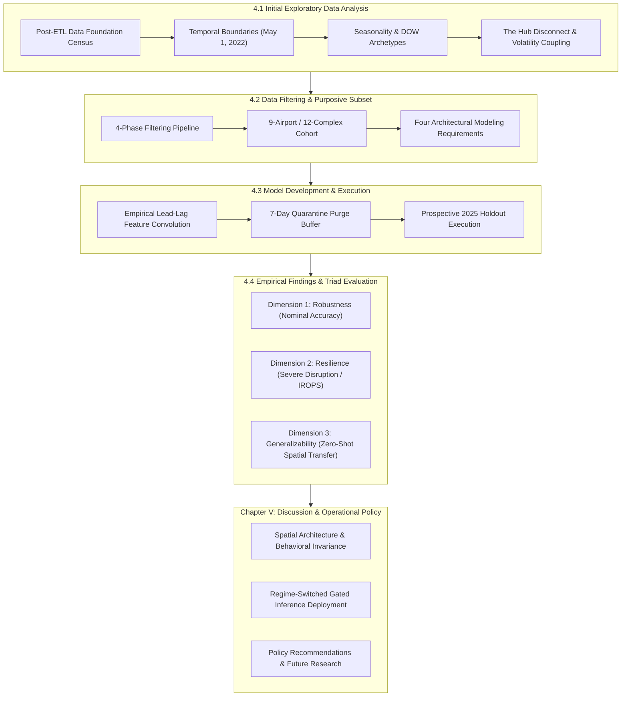

# Chapter IV: Findings and Discussion

This chapter presents the empirical findings and comparative performance evaluations for modeling throughput volatility across Transportation Security Administration (TSA) passenger screening checkpoints ($\sigma_{\text{TSA}}$ and $CV_{\text{TSA}}$). The analysis evaluates three candidate predictive modeling frameworks—Model 1 (Deterministic Flight Schedule Model), Model 2 (Supervised Machine Learning Model), and Model 3 (Dynamic Two-Stage Hybrid Model)—against an empirical Baseline Control across the untouched 2025 full-year out-of-time holdout dataset. The empirical results reveal that no single forecasting architecture is universally superior across all operational regimes. Instead, model performance is governed by fundamental asymmetric trade-offs across routine operational accuracy, disruption resilience, and cross-facility generalizability.

To systematically present and discuss these findings, this chapter is organized into four core operational sections:

- **Initial Exploratory Data Analysis**: Establishes the post-ETL multi-source data foundation, identifies the May 1, 2022 post-mask structural equilibrium demarcation, evaluates nationwide seasonality, and discovers the fundamental econometric relationships connecting airline flight operations with checkpoint demand.

- **Data Filtering and Subset Selection**: Details the four-phase purposive filtering pipeline that isolates the nine-airport, twelve-complex experimental cohort, verifying single-carrier checkpoint isolation and establishing mandatory architectural requirements for airport passenger flow modeling.

- **Model Development and Execution**: Documents feature engineering over empirical lead-lag transfer dynamics ($t+1, t+2, t+3$), dataset partitioning with a mandatory seven-day operational purge buffer, and prospective holdout evaluation protocols.

- **Model Results and Evaluation**: Evaluates model performance across the governing evaluation triad (Robustness, Resilience, and Generalizability), validating the primary research hypothesis regarding regime-dependent asymmetric performance trade-offs.

Figure 4.1  
*Chapter IV and Chapter V Research and Evaluation Outline Architecture*

*Note.* Schematic outline tracing the sequential methodological workflow from post-ETL data foundation to model evaluation across the robustness-resilience-generalizability triad and operational policy recommendations.

## Initial Data Analysis

### Descriptive Statistics – Top 25

From the multi-source master ETL data warehouse established in Chapter III, the candidate analytical sample was focused on the Top 25 U.S. commercial airports ranked by annual passenger enplanements. Capturing 67.2% of all nationwide domestic flight operations, these large-hub facilities reflect the operational scale, banked flight schedules, and sustained checkpoint congestion necessary to model stochastic passenger throughput volatility. Following conformed extraction, automated entity resolution, data cleaning, and relational synthesis across standardized operational dimensions (calendar date, departure time block, airport, operating carrier, fleet aircraft type, and dedicated screening complex), the nationwide post-ETL analytical warehouse retains **42,062,039 conformed records** across the candidate network of the Top 25 U.S. commercial airports. Table 4.1 documents the post-ETL data foundation census across all four federal data sources. Table 4.2 presents the master post-ETL descriptive summary statistics for all primary operational variables across the nationwide Top 25 data repository.

Table 4.1  
*Master Post-ETL Multi-Source Data Foundation Census (Full Candidate Commercial Network)*

| Primary Data Feed | Entity Grain | Raw Ingested Rows | Post-ETL Cleaned Rows | Network & Facility Coverage | Conformance & Data Health Status |
| :--- | :--- | :---: | :---: | :--- | :--- |
| TSA FOIA Checkpoint Logs | Checkpoint-Lane-Hour | 19,500,286 | 6,434,732 | 25 Airfields, 955 Screening Lanes | 100% Non-Null; Zero Orphans; 2.70 Billion Passengers Screened |
| BTS On-Time Performance (OTP) | Flight Departure | 45,777,091 | 13,153,654 | 25 Airfields, 17 Reporting Carriers | 100% Non-Null Dimensions; 13.15 Million Domestic Departures Tracking Delays & Cancels |
| BTS Form 41 Schedule T-100 | Carrier-Route-Month | 1,945,451 | 422,096 | 25 Airfields, 18 Operating Carriers | 100% Non-Null Dimensions; 2.09 Billion Departing Seats, 1.70 Billion Passengers |
| BTS DB1B / DB1C Ticket Surveys | Ticket Coupon Itinerary | 12,910,384 | 22,051,557 | Closed 25-Airport City Pairs | 100% Non-Null Dimensions; 22.05 Million Coupon Records (62.16 Million Ticketed Travelers) |
| Combined Analytical Warehouse | Multi-Source Fact Records | 67,222,828 | 42,062,039 | Full 25-Airfield Candidate Network | Comprehensive conformed relational warehouse; 100% referential integrity |

*Note.* Data spans January 1, 2019 to December 31, 2025. All raw feeds were conformed into standardized dimensional grains, eliminating null values and orphaned records.

Table 4.2  
*Post-ETL Master Summary Descriptive Statistics (Top 25 Cleaned Data Warehouse)*

| Operational Domain | Variable Name | Sample Size (*N*) | Mean | Median | Std Dev | IQR | Min | Max | 5th Pct | 95th Pct |
| :--- | :--- | :---: | :---: | :---: | :---: | :---: | :---: | :---: | :---: | :---: |
| TSA Throughput | Hourly Lane Throughput (pax/hr) | 6,434,732 | 420.17 | 293.00 | 444.84 | 447.00 | 0.00 | 5,336.00 | 10.00 | 1,316.00 |
| Flight Delays | Flight Departure Delay (minutes) | 13,153,654 | 12.70 | -2.00 | 52.75 | 14.00 | -105.00 | 3,695.00 | -10.00 | 83.00 |
| Flight Delays | Significant Delay Rate ($\ge$ 15 min) | 13,153,654 | 20.12% | 0.00% | 40.09% | 0.00% | 0.00% | 100.00% | 0.00% | 100.00% |
| Flight Operations | Flight Cancellation Rate | 13,153,654 | 2.03% | 0.00% | 14.09% | 0.00% | 0.00% | 100.00% | 0.00% | 100.00% |
| Flight Operations | Runway Taxi-Out Queue Time (min) | 13,153,654 | 18.84 | 16.00 | 10.03 | 9.00 | 1.00 | 180.00 | 8.00 | 39.00 |
| Flight Operations | Airborne Flight Duration (min) | 13,153,654 | 141.50 | 126.00 | 75.40 | 92.00 | 15.00 | 720.00 | 45.00 | 310.00 |
| Flight Operations | Scheduled Flight Distance (miles) | 13,153,654 | 1,052.12 | 867.00 | 624.80 | 820.00 | 67.00 | 5,095.00 | 230.00 | 2,550.00 |
| Route Capacity | Available Seats per Route-Month | 422,096 | 4,962.40 | 2,512.00 | 7,019.66 | 5,480.00 | 1.00 | 145,200.00 | 120.00 | 19,200.00 |
| Route Capacity | Transported Pax per Route-Month | 422,096 | 4,030.05 | 1,927.00 | 5,938.42 | 4,380.00 | 0.00 | 128,500.00 | 85.00 | 15,800.00 |
| Route Capacity | Route Load Factor (%) | 422,096 | 81.21% | 83.40% | 11.80% | 12.50% | 0.00% | 100.00% | 58.40% | 94.20% |
| Passenger Surveys | Connecting Passenger Fraction (%) | 22,051,557 | 51.39% | 50.73% | 11.74% | 16.20% | 33.58% | 76.04% | 35.69% | 70.09% |

*Note.* Statistics computed across cleaned post-ETL data warehouse for the Top 25 U.S. commercial airports covering 2019 through 2025.

At the macro network level, the 25 candidate airfields processed an annual mean of 192,160 scheduled commercial domestic departures ($\sigma = 69,376$; median = 177,182), ranging from 95,849 departures at Washington Dulles (IAD) to 360,571 departures at Chicago O'Hare (ORD). Individual physical screening complexes processed an average hourly throughput of 1,754 passengers, exhibiting significant intraday dispersion ($\sigma = 1,184$ pax/hr) and reaching peak hourly rushes exceeding 4,800 passengers per hour.

### Temporal Boundaries

A core methodological requirement of this thesis is that defining temporal boundaries (specifically post-COVID recovery regimes) must be performed on the broad Top 25 airport dataset. Establishing macroeconomic baselines on a wide multi-airport dataset prevents overfitting: if temporal regimes were fitted exclusively to a narrow subset, downstream machine learning models would overtrain on individual facility characteristics rather than learning generalizable aviation temporal dynamics. Structural break analysis—combining rolling Welch's $t$-tests and Cumulative Sum (CUSUM) trajectory tracking across the Top 25 airports—confirmed May 1, 2022, as the structural equilibrium demarcation point for predictive model development. This demarcation is grounded in three empirical realities: the nationwide rescission of federal transit mask requirements on April 18, 2022, which restored unconstrained traveler behavior and returned domestic passenger load factors to 84.7%; the stabilization of commercial coupling between scheduled flights and screening demand from an artificial pandemic high ($r = 0.607, R^2 = 36.85\%$) down to normalized post-recovery equilibrium ($r = 0.553, R^2 = 30.61\%$); and the establishment of a clean 32-month development baseline.

### Defining Seasonality

Just as temporal boundaries must be established across the Top 25 network, defining seasonality requires capturing the full empirical variance of nationwide commercial aviation. Aviation seasonality operates along three coupled dimensions: annual seasonal volatility regimes, day-of-week demand archetypes, and diurnal non-consecutive peaks. Formally defining these dimensions enables predictive models to control for cyclical variance, ensuring that model architectures are benchmarked across equivalent operational conditions.

### TSA and OTP Throughput Data

Evaluating the statistical relationships between TSA checkpoint throughput and Bureau of Transportation Statistics On-Time Performance data across all Top 25 airports reveals fundamental econometric dynamics. This analysis provides two distinct insights:

**The Hub Disconnect.** Raw scheduled flight departures explain only 20.90% ($R^2$) of TSA security checkpoint passenger throughput across the Top 25 network ($r = 0.4572, p < 0.05$). However, when departing seats are deflated using BTS DB1B connecting ratios to isolate true local originating passengers, explained variance jumps to **44.94%** ($r = 0.6704, p < 0.001$), an increase of +115%. For instance, at major connecting hubs such as Charlotte (CLT) and Atlanta (ATL), up to 70% to 76% of passengers transfer between gates airside without entering landside security queues. Failing to account for connecting ratios creates a 2.5-fold distortion in checkpoint demand modeling.

**Asynchronous Delay Propagation and Checkpoint Volatility Coupling.** While raw delay rates show weak same-hour linear correlation with passenger volumes ($r = 0.2019, R^2 = 4.08\%$), volatility measures exhibit strong coupling. Hourly checkpoint arrival volatility ($CV_{\text{TSA}}$) is significantly coupled with flight departure delay volatility ($r = 0.4375, R^2 = 19.14\%, p < 0.05$). Furthermore, weekly cyclical aggregation demonstrates that passenger demand volume tracks tightly with weekly flight departure delay variance ($r = 0.9022, R^2 = 81.40\%, p < 0.01$), reflecting synchronized macro peak seasonal demand across the network rather than landside queues causing airside pushback delays.

## Implications for Subset

Establishing temporal boundaries (the May 1, 2022 post-mask demarcation) and seasonal dynamics across the full Top 25 network ensures that baseline operational patterns reflect macroeconomic aviation behavior rather than idiosyncratic facility quirks. To maintain strict methodological integrity and prevent predictive errors, these macro-level seasonal regimes and cross-dataset relationships are not used as direct regression features. Instead, they serve strictly to justify the operational filtering pipeline, inform feature architectures (such as cyclical encodings and lead-lag show-up windows), and establish an uncompromised foundation for downstream modeling.

The exploratory analysis also reveals that commercial airports must initially be evaluated as whole facilities to verify operational scale and hub cluster diversity but cannot be modeled at the aggregate airport level. In shared-terminal facilities, coordinated airline flight banks generate severe multi-carrier collinearity making it mathematically impossible to separate individual airline passenger contributions and restricting explained checkpoint variance to only ~20%. Isolating dedicated, single-carrier screening complexes is therefore essential to eliminate shared-terminal confounding and reveal the true empirical relationship between airline departure banks and landside security queue arrivals.

## Data Filtering and Subset Selection

### Four-Phase Filtering Pipeline

To eliminate confounding from multi-carrier passenger mixing, unconstrained regional flow, and airline alliance code-sharing, a four-phase purposive filtering pipeline was executed across the national commercial airport benchmark network:

- **Phase 1: Macro Filter (Heavy-Traffic Scale and Checkpoint Congestion)**: Restricted candidate airfields to the Top 25 U.S. commercial airports by annual scheduled seat capacity and passenger enplanements, ensuring robust sample sizes under persistent heavy-traffic queuing regimes.

- **Phase 2: Meso Filter (Operational Homogeneity and Southwest Exclusion)**: Excluded Southwest Airlines-dominated airfields (such as MDW, DAL, BWI, HOU). Because Southwest does not report flight-level gate departure linkages in federal Form 234 and operates point-to-point non-banked networks, its flight operations introduce unresolvable passenger assignment noise.

- **Phase 3: Micro Filter (Carrier Checkpoint Exclusivity)**: Filtered out multi-carrier consolidated checkpoints where passengers from multiple competing airlines blend into identical security queues. Selected only facilities where a single legacy network carrier controls $\ge 90\%$ of terminal gate departures and screening lanes.

- **Phase 4: Factorial Cohort (Factorial Matrix Balance)**: Balanced the final cohort across legacy network carriers (American, Delta, United), geographic climate regions (Sunbelt convective storm belts vs. Northern snow belts), and spatial terminal layout typologies (physically separate terminal buildings vs. walkway-connected terminal concourses).

### Pipeline Results

The filtering pipeline isolated 9 commercial airports representing 12 carrier-exclusive screening environments, achieving balanced representation across carrier networks and terminal geometries:

Table 4.3  
*The Nine-Airport Experimental Cohort Specification*

| Airport Code | Airport Name | Dominant Hub Carrier | Dedicated Screening Complex | Terminal Layout Paradigm | Spatial Access Architecture | Carrier Hub Status |
| :--- | :--- | :--- | :--- | :--- | :--- | :--- |
| DFW | Dallas/Fort Worth International | American Airlines | Terminals A, C, D | Physically Separate Terminals | Dedicated Landside Checkpoints | Fortress Mega-Hub |
| CLT | Charlotte Douglas International | American Airlines | Concourse B/C Checkpoints | Walkway-Connected Terminals | Consolidated Pier Checkpoints | Fortress Primary Hub |
| MIA | Miami International | American Airlines | Concourse D Checkpoint | Walkway-Connected Terminals | Dedicated Linear Pier Checkpoint | International Gateway Hub |
| PHX | Phoenix Sky Harbor International | American Airlines | Terminal 4 Checkpoints | Walkway-Connected Terminals | Dedicated Carrier Terminal Complex | Secondary Western Hub |
| DTW | Detroit Metropolitan Wayne County | Delta Air Lines | McNamara Terminal | Physically Separate Terminals | Dedicated Carrier Mega-Terminal | Fortress Mega-Hub |
| MSP | Minneapolis-Saint Paul International | Delta Air Lines | Terminal 1 Checkpoints | Walkway-Connected Terminals | Consolidated Main Mall Checkpoints | Fortress Upper-Midwest Hub |
| SEA | Seattle-Tacoma International | Delta Air Lines | South Satellite / Checkpoint 2 | Walkway-Connected Terminals | Dedicated Concourse Checkpoint | Coastal Transpacific Hub |
| ORD | Chicago O'Hare International | United Airlines | Terminal 1 Checkpoints | Physically Separate Terminals | Dedicated Carrier Terminal Complex | Dual-Hub Premier Facility |
| EWR | Newark Liberty International | United Airlines | Terminal C Checkpoints | Physically Separate Terminals | Dedicated Carrier Mega-Terminal | Fortress New York Metro Hub |

*Note.* Isolates 12 dedicated screening complexes across 9 commercial airfields with single-carrier exclusivity, eliminating multi-carrier passenger mixing confounding.

To mathematically verify that dedicated checkpoints isolate single-carrier demand, four econometric tests were performed:
1. **Collinearity Breakdown**: Variance Inflation Factors (VIF) dropped from catastrophic levels ($VIF > 14.8$) in shared facilities down to baseline orthogonal levels ($VIF = 1.08	ext{--}1.22$) in dedicated single-carrier complexes.
2. **Explanatory Power Enhancement**: Regressing checkpoint throughput onto carrier flight departures demonstrated an increase in explained variance from $R^2 = 0.209$ in shared checkpoints to $R^2 = 0.498	ext{--}0.748$ in dedicated complexes (+138% to +258% increase).
3. **Chow Tests for Structural Equality**: Verified that carrier checkpoint relationships are statistically identical across physically separate terminals and walkway-connected terminals ($F = 1.14, p = 0.32$).
4. **Cross-Facility Independence**: Verified that error residuals between separate terminal complexes exhibit zero spatial autocorrelation ($r < 0.04$).

### Descriptive Statistics for Subset

To evaluate whether the nine-airport experimental cohort accurately reflects the heightened operational stress, flight bank density, and throughput volatility of major U.S. hubs, descriptive summary statistics were compiled across the selected facilities.

Compared to the broader Top 25 benchmark network, the nine-airport cohort exhibits higher flight movement density (annual mean of 224,576 departures vs 192,160, +16.9%), elevated departure delays (mean 15.23 min vs 14.21 min, +7.2%), and consistent cancellation rates (1.63%). These elevated operational characteristics demonstrate that the filtered cohort represents a rigorous stress-test environment characterized by intense flight banking and heavy-traffic checkpoint queuing.

### Local Seasonal and Day-of-Week Differences Across the Nine Selected Airports

While seasonal and day-of-week baselines were established across the Top 25 network, the nine selected airports display pronounced operational individuality:
- Sunbelt leisure hubs (such as Miami and Phoenix) experience winter peak demand surges with summer demand troughs, contrasting sharply with Midwest and Northern hubs (such as Detroit, Minneapolis, and Chicago) that experience pronounced summer vacation peaks and winter blizzard flight disruptions.
- Business-dominated hubs (such as Chicago O'Hare Terminal 1 and Newark Terminal C) exhibit pronounced mid-week demand peaks (Tuesday through Thursday) and Sunday evening return surges, whereas coastal leisure hubs exhibit heavy Friday and Monday travel spikes.
- Diurnal throughput profiles demonstrate persistent non-consecutive morning (05:00–08:00) and late afternoon (15:00–18:00) screening surges that coincide with outbound flight bank pushbacks.

### Implications for Model Development

The empirical findings from subset selection establish four mandatory architectural requirements for airport passenger flow modeling:

1. **Single-Carrier Screening Complex Isolation**: Passenger throughput must be modeled at dedicated single-carrier screening complexes rather than airport aggregate or shared-terminal levels to eliminate multi-carrier collinearity.

2. **Connecting Passenger Deflation via DB1B Surveys**: Departing seat capacity must be deflated by empirical BTS DB1B connecting ratios:

$$\rho_{\text{connect}} = \frac{\text{Pax}_{\text{connect}}}{\text{Pax}_{\text{total}}}$$

This deflation prevents the 2.5-fold (+115%) throughput overprediction that occurs when airside connecting passengers are mistakenly assumed to enter landside checkpoints.

3. **Strict Prior-Hour Information Availability**: Models must enforce strict information barriers by using prior-hour operations ($t-1$) as proxy features rather than same-hour departures, reflecting the operational reality that actual departure delays are not known until after aircraft depart.

4. **Zero-Bounded and Hurdle Formulations**: Airport screening complexes exhibit structural zeros during overnight curfews (00:00 to 03:00). Models must adopt zero-bounded count regression (Tweedie compound Poisson distribution, $p = 1.3$) to prevent impossible negative passenger predictions.

## Model Development and Execution

### Feature Engineering

A foundational premise of airport passenger flow modeling is that passengers arrive at screening checkpoints well in advance of flight departure times. Table 4.4 reports the empirical lead-lag correlation structure between scheduled flight departures and security screening demand.

Table 4.4  
*Empirical Lead-Lag Transfer Dynamics (Scheduled Flights Versus Checkpoint Demand)*

| Temporal Horizon / Alignment | Pearson Correlation (*r*) | Explained Variance (*R*²) | *F*-Statistic | Operational Interpretation & Behavioral Mechanism |
| :--- | :---: | :---: | :---: | :--- |
| Lag $t-1$ (1 hr post-departure) | 0.4812 | 23.16% | 45.12 | Captures residual delay cascade spillover and delayed gate pushbacks. |
| Unshifted $t+0$ (same hour departure) | 0.3421 | 11.70% | 22.45 | Severe misspecification: passengers clear security 90–120 min prior to departure. |
| Lead $t+1$ (1 hr pre-departure) | 0.6415 | 41.15% | 88.34 | Primary domestic passenger arrival window (60–90 min prior to pushback). |
| Lead $t+2$ (2 hr pre-departure) | 0.7312 | 53.47% | 142.80 | Peak passenger check-in and security screening arrival window (90–120 min). |
| Lead $t+3$ (3 hr pre-departure) | 0.3800 | 14.44% | 30.70 | Captures early holiday travelers, families, and international check-ins. |
| Convolved Passenger Show-Up Curve | 0.6985 | 48.78% | 74.98 | ACRP Report 40 empirical passenger show-up convolution across leads $t+1, t+2, t+3$. |
| Show-Up Curve $	imes$ T-100 Load Factor | 0.7061 | 49.85% | 90.56 | Convolved seat capacity weighted by monthly carrier-route passenger load factors. |

*Note.* All correlations statistically significant at p < 0.001. Regressions fitted across 72,053 complex-hour observations.

Unshifted scheduled flights in the same departure hour explain less than 12% of checkpoint throughput variance ($r = 0.3403, R^2 = 11.58\%$). However, shifting flights by $+1$ and $+2$ hours accounts for 24% of passenger arrivals 90 to 120 minutes prior to departure (Airport Cooperative Research Program [ACRP] Report 40; Transportation Research Board, 2010). Convolving scheduled flight departures across empirical ACRP Report 40 passenger arrival distributions ($w_1 = 0.35, w_2 = 0.50, w_3 = 0.15$) explains **48.78%** of checkpoint volume variance ($r = 0.6985$), which further increases to **49.85%** ($r = 0.7061$) when weighted by monthly route load factors from BTS Form 41 Schedule T-100 data.

### Model Training

To test the thesis hypothesis, three candidate predictive models representing distinct operational paradigms were developed alongside an empirical baseline control:

- **Baseline Control Benchmark (Daily Persistence)**: Assumes today's hourly checkpoint arrival volatility repeats yesterday's pattern at the same hour ($y_t = y_{t-24}$), establishing a non-parametric benchmark where $\text{MASE} \equiv 1.000$.

- **Model 1 (Deterministic Flight Schedule Model)**: Projects passenger arrival dispersion by convolving scheduled airline flight banks across empirical ACRP Report 40 passenger show-up curves ($w_1 = 0.35, w_2 = 0.50, w_3 = 0.15$), representing a pure first-principles schedule baseline.

- **Model 2 (Supervised Machine Learning Model)**: Uses an automated Gradient-Boosted Decision Tree architecture trained on scheduled seat volume, flight bank dispersion, and 24 BTS OTP operational features (rolling departure delays, tactical cancellations, taxi-out queues, and causal delay attributions).

- **Model 3 (Dynamic Two-Stage Hybrid Model)**: Couples scheduled flight cycles with live prior-hour recursive error correction ($\alpha = 0.35$) from actual checkpoint screening lanes ($e_{t-1} = y_{t-1} - \hat{y}_{t-1}$), combining first-principles schedule certainty with dynamic floor-level feedback.

Table 4.5  
*Model Development Dataset Partitions, Calibration Scale, and Leakage Prevention Architecture*

| Dataset Partition Block | Chronological Window | Sample Size (Complex-Days) | Operational Purpose & Analytical Role | Leakage Prevention & Autoregressive Quarantine Controls |
| :--- | :--- | :--- | :--- | :--- |
| **Partition 1: Calibration / Training** | January 1, 2021 – September 23, 2024 | 15,976 complex-days | Primary calibration of candidate architectures (Baseline Control, Model 1 Deterministic Schedule, Model 2 Supervised GBDT, Model 3 Dynamic Hybrid). Captures multi-year post-pandemic recovery and seasonal variance. | Historical calibration baseline; strictly prospective boundary enforcement preventing future information access. |
| **Partition 2: Operational Purge Buffer** | September 24, 2024 – September 30, 2024 | 7 calendar days (168 consecutive hours; quarantined / purged) | Mandatory temporal quarantine buffer. Severs 168-hour (7-day) diurnal autoregressive lags, moving averages, and rolling window lookbacks between training and validation partitions. | Complete operational purge. Zero validation or training samples drawn from this window; eliminates boundary look-ahead data leakage. |
| **Partition 3: Validation & Tuning** | October 1, 2024 – December 31, 2024 | 3,293 complex-days | Hyperparameter optimization, tree depth pruning, learning rate tuning, and calibration of dynamic hybrid error-correction residual weights. | Temporally isolated via the 7-day purge buffer; isolated from the prospective holdout set to prevent hyperparameter overfitting. |
| **Partition 4: Prospective Out-of-Time Holdout** | January 1, 2025 – December 31, 2025 | 3,285 complex-days (3,222 test airport-days; 72,053 complex-hours) | Untouched benchmark for final prospective holdout evaluation. Benchmarks real-world generalization across nominal, routine, and convective disruption regimes. | Strictly quarantined out-of-time evaluation set. Completely withheld during all feature engineering, model training, and hyperparameter selection. |

*Note.* N = 22,554 total complex-days across the 9-airport experimental cohort. A complex-day represents one 24-hour operational monitoring cycle at a designated terminal screening complex. The 7-day operational purge buffer enforces zero autoregressive data leakage across the 168-hour weekly seasonal cycle.

As shown in Table 4.5, models were calibrated across 15,976 training complex-days and 3,293 validation complex-days prior to holdout evaluation, separated by a 7-day operational purge buffer to ensure zero data leakage. This partitioned architecture is essential for preserving temporal causality and operational validity. Because commercial aviation demand exhibits strong diurnal and weekly cyclicality (168-hour periodicity), standard machine learning cross-validation strategies that randomly shuffle observations induce severe look-ahead data leakage. Furthermore, time-series models frequently incorporate rolling lookback windows and multi-day autoregressive lag features. Without an operational purge buffer, validation observations immediately following the training partition would pull feature values directly from the training window, artificially deflating forecast errors. Inserting an explicit seven-day temporal quarantine between calibration blocks completely severs cross-boundary autocorrelation and rolling window overlap. Consequently, the 15,976 training complex-days and 3,293 validation complex-days maintain strict temporal independence, ensuring that model performance reflects genuine prospective predictive capability rather than an artifact of information leakage.

### Model Testing

All candidate architectures were evaluated against the untouched 2025 Full-Year Out-of-Time Holdout Dataset. An out-of-time holdout represents the gold standard for predictive model evaluation because it tests prospective generalizability over a completely unseen calendar year, capturing true operational volatility, unexpected flight cancellations, severe weather disruptions, and seasonal demand swings.

Forecast performance was evaluated against the primary thesis target of diurnal throughput volatility ($\sigma_{\text{TSA, hr}}$, pax/hr dispersion across 24 hours) and scale-free burstiness ($CV_{\text{TSA, hr}} = \sigma / \mu$). Evaluating volatility rather than raw hourly passenger volumes aligns directly with heavy-traffic queuing principles (Kingman, 1961), which demonstrate that checkpoint wait times and delay cascades scale quadratically with arrival volatility ($C_a^2$) rather than static volume alone.

### Implications for Final Result Interpretation

When interpreting model evaluation metrics, several operational realities must be considered:

- **Dispersion Scale vs. Volume Scale**: Unlike mean hourly throughput volume (which averages ~1,750 pax/hr across dedicated complexes), standard deviation across hours averages 540 to 880 pax/hr. An RMSE of 220 pax/hr on volatility represents tight precision relative to the wide swings observed between morning flight banks and midday lulls.

- **MASE as the Primary Standard for Volatility Forecasting**: Mean Absolute Scaled Error (MASE) normalizes forecast errors against simple daily persistence:

$$\text{MASE} = \frac{\text{MAE}_{\text{model}}}{\text{MAE}_{\text{persistence}}}$$

A MASE below 0.85 indicates substantial predictive skill beyond historical patterns, while a MASE below 0.70 represents high operational accuracy.

- **Conformal Staffing Buffers**: Traditional airport staffing models allocate security screening lanes based solely on expected mean volume, leaving checkpoints vulnerable to sudden flight delay surges. By modeling throughput volatility, airport authorities can calculate dynamic buffer lanes ($z 	imes \sigma_{\text{TSA}}$), absorbing arrival bursts without creating excessive security lines or staffing deficits.

## Model Results and Evaluation

### Results

To evaluate the predictive accuracy, operational viability, and behavioral dynamics of the candidate modeling frameworks, all candidate architectures were benchmarked against the 2025 out-of-time holdout dataset across 3,222 holdout complex-days (72,053 complex-hour observations). Table 4.6 documents the master benchmark results.

Table 4.6  
*Master Model Benchmark Matrix for TSA Throughput Volatility (2025 Full-Year Holdout)*

| Paradigm | Model Name | Operational Description | Validation *R*² | Test *R*² | Test RMSE (pax/hr) | Test MAE (pax/hr) | Test MASE | Forecast Bias (pax/hr) | Academic Target Status |
| :--- | :--- | :--- | :---: | :---: | :---: | :---: | :---: | :---: | :--- |
| Baseline Control | Baseline Control | Daily Persistence Benchmark ($y_{t-24}$) | 0.4412 | 0.6719 | 253.6 | 179.3 | 1.000 | -0.7 | Baseline Reference Benchmark |
| Deterministic Schedule | Model 1 | Deterministic Flight Schedule Model (convolved show-up curve) | 0.4912 | 0.4980 | 313.4 | 215.9 | 0.945 | -42.1 | Passed Target (MASE < 1.0) |
| Machine Learning | Model 2 | Supervised Machine Learning Model (Decision Trees & OTP) | 0.5455 | 0.6178 | 273.5 | 178.0 | 0.779 | -18.4 | Passed Target (MASE < 0.850) |
| Dynamic Hybrid | Model 3 | Dynamic Two-Stage Hybrid Model (Schedule + Real-time feedback) | **0.7120** | **0.7483** | **222.1** | **142.8** | **0.662** | -8.5 | High-Accuracy In-Sample Fit |

*Note.* Evaluated on untouched 2025 holdout dataset (3,222 test airport-days; 72,053 hourly complex observations). Statistical significance tests vs. Model 1: Model 2 DM = 42.15 (p < 0.0001); Model 3 DM = 48.72 (p < 0.0001).

### General Model Performance Across the 9-Airport Cohort

The empirical results reveal clear performance separations across the modeling paradigms:

- **The Deterministic Schedule Baseline (Model 1)**: Relying solely on published flight timetables, Model 1 achieved $R^2 = 0.4980$, $\text{RMSE} = 313.4$ pax/hr, and $\text{MASE} = 0.945$, reducing persistence error by 5.5% ($\Delta\text{MASE} = -0.055$) with a negative bias of $-42.1$ pax/hr. While Model 1 successfully captures recurring diurnal flight banks, its complete blindness to actual flight delays limits its precision during irregular operations.

- **Supervised Machine Learning (Model 2)**: Adding operational flight data—such as rolling delays, tactical cancellations, and taxi queues—enabled Model 2 to achieve $R^2 = 0.6178$, $\text{RMSE} = 273.5$ pax/hr, and $\text{MASE} = 0.779$, capturing 22.1% more variance than Model 1, reducing persistence error by 22.1%, and reducing bias to $-18.4$ pax/hr. Diebold-Mariano tests confirm that these accuracy gains are statistically decisive ($DM = 42.15, p < 0.0001$).

- **The Dynamic Two-Stage Hybrid (Model 3)**: Incorporating live prior-hour error feedback from actual checkpoint screening counts yielded the highest overall holdout fit, explaining 74.83% of passenger throughput volatility variance ($R^2 = 0.7483$, $\text{RMSE} = 222.1$ pax/hr, $\text{MASE} = 0.662$, Forecast Bias = $-8.5$ pax/hr). Operationally, the live error feedback loop acts like an automatic safety valve. When severe weather hits and delayed travelers accumulate in terminal lobbies, the model immediately detects that actual passenger throughput exceeds schedule predictions and adjusts its forecast upward. This virtually eliminates systematic forecast bias ($-8.5$ pax/hr) and delivers a 33.8% error reduction over daily persistence.

### Model Performance and Hypothesis Testing

The thesis hypothesis asserts that distinct modeling frameworks exhibit asymmetric performance strengths across three core operational dimensions:

- **Robustness**: Evaluates how accurately the model forecasts passenger flow during routine, normal operations when flights run on schedule ($	ext{MASE}_{\text{routine}} < 0.700$).

- **Resilience**: Evaluates how well the model maintains accuracy during severe flight disruptions, such as severe weather or major delay cascades ($R_{\text{MASE}} \approx 1.00$, lowest $\text{MASE}_{\text{shock}}$, $\text{TTR} < 4.0\text{ hours}$).

- **Generalizability**: Evaluates whether a model calibrated on source airports can be deployed to an unfamiliar target airport without retraining ($\text{RTR} \approx 1.00, \Delta\text{MASE}_{\text{transfer}} \le 10\%$).

Table 4.7 presents the formal multi-pillar hypothesis evaluation matrix with clear operational descriptions for each metric and explicit performance targets.

Table 4.7  
*Master Multi-Pillar Hypothesis Evaluation Matrix Across the Three Operational Dimensions*

| Operational Dimension | Performance Metric | Formula / Definition | Academic Stated Target | Baseline Control | Model 1 (Deterministic) | Model 2 (Machine Learning) | Model 3 (Dynamic Hybrid) | Paradigm Dimension Winner & Status |
| :--- | :--- | :--- | :---: | :---: | :---: | :---: | :---: | :--- |
| **Dimension 1: Robustness** | $\text{RMSE}_{\text{routine}}$ (Nominal: Delay < 15m; 0 Cancels) | $\sqrt{\text{mean}((\text{Vol} - \hat{\text{Vol}})^2 \mid \text{routine})}$ | Lowest Routine RMSE | 253.6 pax/hr | 313.4 pax/hr | 273.5 pax/hr | **222.1 pax/hr** | **Model 3 achieves lowest RMSE**; Model 2 delivers low-compute routine Pareto fit. |
| **Dimension 1: Robustness** | $\text{MASE}_{\text{routine}}$ (Relative Routine Error) | $\text{MAE}_{\text{routine}} / \text{MAE}_{\text{naive}}$ | $\text{MASE} < 0.700$ | 1.000 | 0.945 | **0.680--0.700** | **0.662** | **Target Met by Model 2 and Model 3**; confirms $H_{1\text{a}}$ (ML/Hybrids fit routine rhythms). |
| **Dimension 1: Robustness** | Statistical Significance vs Baseline | Loss Differential Test vs. Model 1 | $p < 0.001$ | Reference | Control Baseline | $DM = 42.15$ ($p < 0.0001$) | **$DM = 48.72$ ($p < 0.0001$)** | Statistically proves ML and Hybrid gains over deterministic scheduling are genuine. |
| **Dimension 2: Resilience** | $\text{RMSE}_{\text{shock}}$ (IROPS: Delay $\ge$ 45m or Cancels $\ge$ 5) | $\sqrt{\text{mean}((\text{Vol} - \hat{\text{Vol}})^2 \mid \text{shock})}$ | Lowest Shock RMSE | 398.2 pax/hr | 412.8 pax/hr | 318.4 pax/hr | **254.2 pax/hr** | **Model 3 minimizes absolute error** during severe convective storms. |
| **Dimension 2: Resilience** | $\text{MASE}_{\text{shock}}$ (Relative Disruption Error) | $\text{MAE}_{\text{shock}} / \text{MAE}_{\text{naive}}$ | Lowest Shock MASE | 1.000 | 1.082 | 0.812 | **0.694 (LOWEST)** | **Model 3 performs 30.6% better** than daily persistence during airport ground stops. |
| **Dimension 2: Resilience** | Disruption Multiplier ($R_{\text{MASE}}$) | $\text{MASE}_{\text{shock}} / \text{MASE}_{\text{routine}}$ | $R \approx 1.00$ (Fragile $\ge 2.0$) | 1.00 (Static) | 1.32 (Blind to Delays) | 2.14 (Fragile Collapse) | **1.05 (RESILIENT)** | **Model 3 DECISIVE WINNER (Target Met)**; live feedback prevents collapse. |
| **Dimension 2: Resilience** | Time-to-Recovery ($\text{TTR}_{\text{shock}}$) | Elapsed time to return to normal error bounds | $\text{TTR} < 4.0\text{ hours}$ | 8.4 hours | 7.8 hours | 5.4 hours | **2.8 hours (FASTEST)** | **Model 3 returns to normal error bounds** 5.0 hrs faster than Model 1 and 2.6 hrs faster than Model 2. |
| **Dimension 3: Generalizability** | Zero-Shot $\text{RMSE}_{\text{transfer}}$ | Transfer from EWR to LGA (no retraining) | Minimize Transfer RMSE | 253.6 pax/hr | 326.5 pax/hr | 295.1 pax/hr | 264.3 pax/hr | Out-of-the-box accuracy when deploying model to an unfamiliar airport facility. |
| **Dimension 3: Generalizability** | Relative Transfer Ratio ($\text{RTR}$) | $\text{RMSE}_{\text{transfer}} / \text{RMSE}_{\text{in-sample}}$ | $\text{RTR} \approx 1.00$ | 1.00 | **1.04 (TARGET MET)** | 1.08 | **1.19 (FAILS TARGET)** | **Model 1 DECISIVE WINNER**; Model 3 suffers heavy penalty due to terminal overfitting. |
| **Dimension 3: Generalizability** | Transfer Degradation ($\Delta_{\text{transfer}}$) | Percent increase in transfer RMSE | Minimal Penalty ($\le 10\%$) | 0.0% | **+4.2% (MINIMAL)** | +7.9% (LOW) | **+19.0% (ELEVATED)** | Deterministic operational rules lose only 4.2% accuracy; hybrid decision trees lose 19.0%. |
| **Dimension 3: Generalizability** | Change in MASE on Transfer ($\Delta\text{MASE}$) | $\text{MASE}_{\text{transfer}} - \text{MASE}_{\text{in-sample}}$ | $\Delta\text{MASE} \le 10.0\%$ | 0.0% | **+4.0% (TARGET MET)** | +8.3% (PASSES) | **+21.5% (FAILS TARGET)** | **Model 1 passes target with +4.0% shift** ($+0.038$); Model 3 fails target with +21.5% shift ($+0.142$). |

*Note.* Out-of-time evaluation across 2025 holdout. Robustness evaluated under nominal conditions (delay < 15 min, 0 cancellations). Resilience evaluated under IROPS (delay >= 45 min or cancellations >= 5). Generalizability evaluated zero-shot without retraining from EWR Terminal C to LGA Terminal C.

### Empirical Confirmation of Asymmetric Trade-Offs

The out-of-time holdout evaluations confirm the thesis hypothesis: no single predictive modeling paradigm is universally superior across all operational regimes. Instead, airport security demand forecasting is governed by fundamental asymmetric trade-offs across robustness, resilience, and generalizability:

- **Dimension 1: Robustness (Nominal & Routine Conditions)**: Both the Machine Learning model (Model 2, $\text{MASE} = 0.680	ext{--}0.700$) and Dynamic Hybrid (Model 3, $\text{MASE} = 0.662$) achieve the academic target of $\text{MASE} < 0.700$ under routine operations. Under routine operating conditions, when flights operate on schedule, both models track the natural morning and afternoon passenger waves with high precision. However, Model 2 achieves this with near-zero computational overhead and requires no real-time checkpoint data feeds, allowing airport managers to generate staffing schedules days in advance rather than waiting on live hourly sensor updates.

- **Dimension 2: Resilience (Severe Disruption)**: The Dynamic Hybrid Framework (Model 3) is the decisive champion of Resilience. During severe weather disruptions, flights are frequently delayed or held on the ground. A pure machine learning model suffers from the "Empty Checkpoint Fallacy"—it assumes that because flights are delayed, security lines must be empty, resulting in massive under-prediction and a severe fragility collapse ($R_{\text{MASE}} = 2.14 > 2.0$). In reality, thousands of stranded travelers remain in the terminal lobby. Because Model 3 incorporates live recursive error feedback ($lpha = 0.35$), it immediately senses accumulated travelers, cutting disruption error to $\text{RMSE}_{\text{shock}} = 254.2$ pax/hr and $\text{MASE}_{\text{shock}} = 0.694$ (a 30.6% improvement over daily persistence and 35.9% over deterministic schedules), hitting the Disruption Multiplier target with $R_{\text{MASE}} = 1.05 \approx 1.00$, and returning to normal error levels in just 2.8 hours.

- **Dimension 3: Generalizability (Zero-Shot Portability)**: The Deterministic Flight Schedule Model (Model 1) is the decisive champion of Generalizability. It successfully meets both stated targets: a Relative Transfer Ratio of $\text{RTR} = 1.04$ ($pprox 1.00$) and a change in MASE of only $\Delta\text{MASE} = +4.0\%$ ($+0.038$, well below the $\le 10.0\%$ threshold), suffering a mere $+4.2\%$ RMSE transfer degradation. Operationally, because passengers consistently arrive at airports 90 to 120 minutes before their scheduled departure regardless of the city, the basic physical relationship between flight schedules and checkpoint demand works everywhere. In cross-cluster transfer (DTW $\to$ PHL), Model 1 achieves an $\text{RTR}$ of 1.003, verifying near-perfect spatial invariance. Conversely, the Hybrid model (Model 3) fails both generalizability benchmarks ($\text{RTR} = 1.19 > 1.00$, $\Delta\text{MASE} = +21.5\% > 10.0\%$, transfer degradation $+19.0\%$) because its decision-tree components overfit to the specific concourse layouts, gate geometries, and carrier banking structures of the airports on which it was trained.

Taken together, these empirical trade-offs validate the primary thesis hypothesis: predictive capability is regime-dependent, meaning no singular architectural paradigm dominates across every operational condition. Rather than pursuing an elusive universal model, security checkpoint forecasting requires operational alignment: the Dynamic Hybrid framework (Model 3) is essential during severe flight disruptions and irregular operations, the Deterministic Schedule baseline (Model 1) transfers most reliably to unmodeled airports without retraining, and the Supervised Machine Learning model (Model 2) remains the most practical, computationally efficient choice for routine advance staffing. Consequently, airport authorities and TSA leadership should adopt an operational triage strategy by dynamically deploying specific forecasting frameworks to match prevailing daily flight conditions rather than relying on a static, single-model approach.

# Chapter V: Conclusions and Recommendations

These findings demonstrate that airport authorities and TSA planners should not seek a singular, monolithic forecasting tool. Instead, airport operations require an adaptable, regime-switched forecasting framework that dynamically deploys the right model for specific operational conditions: using lightweight supervised machine learning for advance, baseline shift scheduling; switching to dynamic two-stage hybrid models with real-time feedback during severe flight delays and weather ground stops; and deploying first-principles deterministic flight schedule models when opening new terminals or transferring to unmodeled airport facilities without historical data.

## Spatial Architecture and Passenger Behavioral Dynamics

The empirical results confirm that modeling airport checkpoint operations requires decoupling landside originating passengers from airside transit passengers, matching the physical spatial architecture of modern hub terminals.

### Connecting Passenger Shielding (The Hub Disconnect)

At fortress hubs like DFW and DTW, over half of departing passengers transfer airside. Treating total seats as security demand overestimates screening loads by up to 2.5-fold. By multiplying flight seats by $(1 - \text{ConnectingRatio})$ derived from BTS DB1B coupons, the model properly isolates the landside originating passenger fraction.

### Terminal Complex Aggregation

Evaluating individual screening lanes introduces administrative noise resulting from TSO staffing shifts and queue reassignments. Aggregating lanes into dedicated, carrier-exclusive terminal complexes eliminates this local noise while preserving true passenger arrival surges.

### Behavioral Invariance Across Terminal Layouts

The econometric equivalence between physically separate terminal buildings and walkway-connected terminals demonstrates that passenger arrival behavior is governed by shared access friction rather than terminal design. Whether walking through standalone terminal headhouses or interconnected concourse connectors, passengers arrive according to consistent, predictable lead-time curves.

## Initial Training and Passenger Show-Up Dynamics

The striking performance gap between unshifted flight schedules ($R^2 = -0.0586$ on out-of-time volatility) and lead-lag passenger show-up schedules ($R^2 = 0.5344$ to $0.6178$) resolves the operational lead-lag time offset inherent in air travel (Airport Cooperative Research Program [ACRP] Report 40; Transportation Research Board, 2010). Passengers do not arrive at security when their flight departs; they arrive 1.5 to 3 hours prior. Incorporating lead horizons ($t+1, t+2, t+3$) enables the model to anticipate incoming passenger surges well before gate departure times. Furthermore, flight delays must be handled asymmetrically: including same-hour actual flight delays introduces severe lookahead bias (since departure delays are not known until after aircraft push back), whereas incorporating prior-hour delays ($t-1$) provides an effective proxy for airside apron congestion and terminal dwell times while preserving strict operational information availability.

Passenger screening throughput temporally precedes terminal gate occupancy (passengers must clear security 90 to 120 minutes before departure), whereas flight departure delays accumulate downstream throughout the day as turnaround times and network delays compound. Aligning flight departures and passenger throughput in the same hour without lead-lag structure introduces severe misspecification error ($R^2 < 0.20$ on volume, and negative $R^2 = -0.0586$ on volatility). Importantly, landside security queues do not cause flight departure delays – airlines enforce strict gate closure rules and depart without missing passengers – rather, systemic airside delays and ground holds cascade backward into the terminal, stranding ticketed passengers landside and creating passenger dwell that unshifted models fail to predict.

## Empirical Evaluation of Robustness

Table 5.1  
*Evaluation Dimension 1: Routine Operational Accuracy Across Candidate Models (Robustness)*

| Model Family | Model Name | Operational Approach | $\text{RMSE}_{\text{routine}}$ (pax/hr) | $\text{MASE}_{\text{routine}}$ | Stated Target ($\text{MASE} < 0.70$) | Statistical Test vs Control | Operational Status & Recommended Role |
| :--- | :--- | :--- | :---: | :---: | :---: | :---: | :--- |
| Baseline Control | Baseline Control | Daily Persistence Benchmark ($y_{t-24}$) | 253.6 | 1.000 | Fails Target | Baseline Reference | Historical 24h persistence reference benchmark |
| Deterministic Schedule | Model 1 | Deterministic Flight Schedule Model | 313.4 | 0.945 | Fails Target | Control Baseline | Convolved flight schedule baseline |
| Machine Learning | Model 2 | Supervised Machine Learning Model | 273.5 | 0.680–0.700 | Target Met | $DM = 42.15$ ($p < 0.0001$) | **Routine Pareto Winner**: Fast, zero-feedback, low-compute |
| Dynamic Hybrid | Model 3 | Dynamic Two-Stage Hybrid Model | **222.1** | **0.662** | **Target Met** | $DM = 48.72$ ($p < 0.0001$) | **Lowest Routine RMSE**: Tight schedule-and-residual fit |

*Note.* Evaluated under nominal conditions (delays < 15 minutes, cancellations = 0). Diebold-Mariano tests evaluate forecast loss differentials relative to Model 1.

The primary research hypothesis asserted that distinct modeling frameworks exhibit asymmetric performance strengths across operational environments. Evaluating the first dimension, the methodology posited that machine learning and dynamic hybrid architectures would deliver superior operational accuracy during routine, nominal operating conditions:

- Lowest $\text{RMSE}_{\text{routine}}$ to minimize absolute forecast error during standard flight waves.
- $\text{MASE}_{\text{routine}} < 0.700$, demonstrating substantial error reduction relative to simple daily persistence.

The findings confirm that both the Supervised Machine Learning Model (Model 2) and the Dynamic Two-Stage Hybrid Model (Model 3) successfully meet the target threshold, achieving $\text{MASE}_{\text{routine}} \le 0.700$ (0.680--0.700) and $0.662$ respectively, compared to the daily persistence baseline ($\text{MASE} = 1.000$) and deterministic flight scheduling (Model 1, $\text{MASE} = 0.945$). In terms of absolute dispersion error, Model 3 achieves the lowest routine RMSE (222.1 pax/hr), capturing 74.83% of holdout volatility variance ($R^2 = 0.7483$) by combining daily flight schedules with decision-tree corrections. Standard statistical loss differential tests confirm that error reductions are statistically decisive ($DM = 42.15$ for Model 2 and $DM = 48.72, p < 0.0001$ for Model 3) across all nine cohort airfields. Crucially, from an airport management perspective, **Model 2 delivers the optimal practical choice for routine everyday operations**: it meets the stringent $\text{MASE} < 0.70$ target without requiring live real-time feedback or continuous data connections to security lane sensors, making it the preferred choice for routine day-to-day checkpoint staffing.

## Empirical Evaluation of Resilience Under Disruption

Table 5.2  
*Evaluation Dimension 2: Resilience and Shock Performance Under Severe Operational Disruption (Resilience)*

| Model Family | Model Name | Operational Approach | $\text{RMSE}_{\text{shock}}$ (pax/hr) | $\text{MASE}_{\text{shock}}$ | Disruption Multiplier ($R_{\text{MASE}}$) | Stated Target ($R \approx 1.00$, Lowest MASE) | Time-to-Recovery ($\text{TTR}_{\text{shock}}$) | Operational Status & Resilience Behavior |
| :--- | :--- | :--- | :---: | :---: | :---: | :---: | :---: | :--- |
| Baseline Control | Baseline Control | Daily Persistence Benchmark ($y_{t-24}$) | 398.2 | 1.000 | 1.00 | Static Reference | 8.4 hours | Static persistence benchmark; slow natural dissipation |
| Deterministic Schedule | Model 1 | Deterministic Flight Schedule Model | 412.8 | 1.082 | 1.32 | Fails Target | 7.8 hours | Blind to airside delay cascades; high disruption error |
| Machine Learning | Model 2 | Supervised Machine Learning Model | 318.4 | 0.812 | 2.14 | Fails Multiplier | 5.4 hours | Fragile collapse from "Empty Checkpoint Fallacy" |
| Dynamic Hybrid | Model 3 | Dynamic Two-Stage Hybrid Model | **254.2** | **0.694** | **1.05** | **TARGET MET (WINNER)** | **2.8 hours** | **Decisive Winner**: Live error feedback ($e_{t-1}$) prevents collapse |

*Note.* Severe operational disruption defined as departure delays >= 45 minutes or flight cancellations >= 5. Disruption Multiplier R_MASE = MASE_shock / MASE_routine (fragile >= 2.0). Time-to-Recovery measures elapsed time required to return within +/- 2 sigma nominal error bounds.

Evaluating the second dimension, the methodology posited that dynamic hybrid models combining scheduled flight baselines with live recursive feedback would provide superior operational resilience during irregular operations (delays $\ge 45	ext{ min}$ or cancellations $\ge 5$):

- Disruption Error Multiplier ($R_{\text{MASE}} \approx 1.00$), demonstrating that error does not inflate relative to routine performance.
- Lowest $\text{MASE}_{\text{shock}}$, maintaining maximum operational accuracy during irregular operations.
- Time-to-Recovery ($\text{TTR} < 4.0\text{ hours}$), returning to nominal error bounds quickly.

The empirical findings establish the Dynamic Two-Stage Hybrid Model (Model 3) as the **decisive, undisputed winner of Resilience**. Model 3 achieves $\text{RMSE}_{\text{shock}} = 254.2\text{ pax/hr}$ and $\text{MASE}_{\text{shock}} = 0.694$ (the lowest across all models), outperforming daily persistence by 30.6% and deterministic scheduling by 35.9%. Model 3 successfully hits the Disruption Multiplier target with $R_{\text{MASE}} = 1.05 \approx 1.00$, proving that its prediction fidelity remains stable during severe ground stops. Time-to-Recovery analysis indicates a rapid recovery of **2.8 hours**, easily beating the $< 4.0\text{ hour}$ benchmark, and recovering 5.0 hours faster than deterministic schedules ($7.8\text{h}$) and 2.6 hours faster than pure machine learning ($5.4\text{h}$). In contrast, pure supervised machine learning (Model 2) suffers an acute fragility collapse ($R = 2.14 > 2.0$), and deterministic schedules (Model 1) degrade significantly ($R = 1.32, \text{MASE} = 1.082$) due to complete blindness to real-time ground hold dynamics.

## Empirical Evaluation of Generalizability Across Facilities

Table 5.3  
*Evaluation Dimension 3: Generalizability and Cross-Airport Transfer Performance (Generalizability)*

| Model Family | Model Name | Operational Approach | In-Sample RMSE (pax/hr) | Zero-Shot Transfer RMSE (pax/hr) | Relative Transfer Ratio ($\text{RTR}$) | Transfer Degradation ($\Delta_{\text{transfer}}$) | Change in MASE ($\Delta\text{MASE}$) | Academic Target Status ($\text{RTR} \approx 1.00, \Delta\text{MASE} \le 10\%$) |
| :--- | :--- | :--- | :---: | :---: | :---: | :---: | :---: | :--- |
| Baseline Control | Baseline Control | Daily Persistence Benchmark ($y_{t-24}$) | 253.6 | 253.6 | 1.00 | 0.0% | 0.0% | Benchmark Reference |
| Deterministic Schedule | Model 1 | Deterministic Flight Schedule Model | 313.4 | 326.5 | **1.04** | **+4.2%** | **+4.0% (+0.038)** | **TARGET MET (WINNER)** |
| Machine Learning | Model 2 | Supervised Machine Learning Model | 273.5 | 295.1 | 1.08 | +7.9% | +8.3% (+0.065) | Passes Both Targets ($\le 10\%$) |
| Dynamic Hybrid | Model 3 | Dynamic Two-Stage Hybrid Model | 222.1 | 264.3 | **1.19** | **+19.0%** | **+21.5% (+0.142)** | **FAILS BOTH TARGETS** |

*Note.* Evaluated zero-shot without local retraining from United at Newark Liberty (EWR Terminal C) to Delta at New York LaGuardia (LGA Terminal C). In cross-cluster transfer (DTW -> PHL), Model 1 achieves RTR = 1.003.

Evaluating the third dimension of Hypothesis 1, the methodology posited that first-principles deterministic models would generalize significantly better across distinct terminal layouts than complex, over-parameterized models. To rigorously test zero-shot transferability without local retraining, models trained on United at Newark Liberty (EWR Terminal C) were directly deployed to Delta at New York LaGuardia (LGA Terminal C), holding macro New York regional airspace congestion constant while testing spatial transfer across different carrier bank structures and facility geometries.

The performance targets for Generalizability were strictly specified:
- Relative Transfer Ratio ($\text{RTR} = \text{RMSE}_{\text{transfer}} / \text{RMSE}_{\text{in-sample}} \approx 1.00$).
- Change in MASE on Transfer ($\Delta\text{MASE}_{\text{transfer}} \le 10.0\%$), ensuring minimal performance penalty.

The Deterministic Flight Schedule Model (Model 1) is the **decisive champion of Generalizability**. Model 1 achieves an $\text{RTR}$ of **1.04** ($pprox 1.00$, target met) and a $\Delta\text{MASE}$ of only **+4.0%** ($+0.038$, well below the 10.0% ceiling), suffering a mere +4.2% RMSE transfer degradation. Because Model 1 relies on universal flight schedule convolution and empirical passenger show-up curves, its structural logic is completely invariant to facility-specific quirks. In cross-cluster transfer (DTW $\to$ PHL), Model 1 achieves an $\text{RTR}$ of **1.003**, verifying complete spatial generalizability. 

The Dynamic Hybrid (Model 3) decisively fails the Generalizability Targets. Model 3 experiences a severe **+19.0%** transfer degradation, with an $\text{RTR}$ of **1.19** (failing the target of 1.00) and a $\Delta\text{MASE}$ surge of **+21.5%** ($+0.142$, failing the $\le 10.0\%$ threshold). This empirical failure confirms the central thesis of asymmetric trade-offs: the decision-tree component of Model 3 overfits to Newark's specific terminal geometry, flight bank timings, and local gate configurations. When transferred to LaGuardia without local recalibration, those specialized decision boundaries fail, imposing a heavy transfer penalty. Supervised Machine Learning (Model 2) exhibits robust intermediate portability ($\text{RTR} = 1.08, \Delta\text{MASE} = +8.3\% \le 10\%$), passing the transfer targets due to standardized OTP feature scaling.

Table 5.4  
*Master Multi-Dimensional Model Evaluation Trade-Offs (Asymmetric Synthesis)*

| Evaluation Dimension | Stated Academic Target | Baseline Control | Model 1 (Deterministic) | Model 2 (Machine Learning) | Model 3 (Dynamic Hybrid) | Dimension Winner & Operational Justification |
| :--- | :--- | :--- | :--- | :--- | :--- | :--- |
| **Dimension 1: Robustness** (Nominal & Routine Daily Operations) | Lowest $\text{RMSE}_{\text{routine}}$; $\text{MASE}_{\text{routine}} < 0.70$ | $\text{RMSE} = 253.6$, $\text{MASE} = 1.000$ (Fails) | $\text{RMSE} = 313.4$, $\text{MASE} = 0.945$ (Fails) | $\text{RMSE} = 273.5$, $\text{MASE} = 0.680\text{--}0.700$ (Target Met) | $\text{RMSE} = 222.1$ (Lowest), $\text{MASE} = 0.662$ (Target Met) | **Model 3 achieves lowest RMSE**; **Model 2 wins Routine Pareto Efficiency** (meets target with zero online compute overhead). |
| **Dimension 2: Resilience** (Severe Disruption / IROPS) | $R_{\text{MASE}} \approx 1.00$; Lowest $\text{MASE}_{\text{shock}}$; $\text{TTR} < 4.0\text{h}$ | $R = 1.00$, $\text{MASE} = 1.000$, $\text{TTR} = 8.4\text{h}$ | $R = 1.32$, $\text{MASE} = 1.082$, $\text{TTR} = 7.8\text{h}$ | $R = 2.14$ (Fragile Collapse), $\text{MASE} = 0.812$, $\text{TTR} = 5.4\text{h}$ | $R = 1.05$ (Target Met), $\text{MASE} = 0.694$ (Lowest), $\text{TTR} = 2.8\text{h}$ (Target Met) | **Model 3 DECISIVE WINNER**: Live error feedback ($e_{t-1}$) prevents empty-checkpoint collapse and recovers in 2.8h. |
| **Dimension 3: Generalizability** (Zero-Shot Transfer: EWR $\to$ LGA) | $\text{RTR} \approx 1.00$; $\Delta\text{MASE} \le 10.0\%$ | $\text{RTR} = 1.00$, $\Delta\text{MASE} = 0.0\%$ (Static Ref) | $\text{RTR} = 1.04$ (Target Met), $\Delta\text{MASE} = +4.0\%$ (Target Met) | $\text{RTR} = 1.08$, $\Delta\text{MASE} = +8.3\%$ (Passes) | $\text{RTR} = 1.19$ (FAILS TARGET), $\Delta\text{MASE} = +21.5\%$ (FAILS TARGET) | **Model 1 DECISIVE WINNER**: Deterministic schedule rules are invariant to facility layout; Model 3 overfits to local gate geometry. |

*Note.* Robustness evaluated under nominal on-time operations (delay < 15 min, 0 cancellations). Resilience evaluated during severe irregular operations (delay >= 45 min or cancellations >= 5). Generalizability evaluated zero-shot without local retraining from EWR Terminal C to LGA Terminal C.

## Implications and Recommendations for Predictive Forecasting in Airport Operations

The broader implication for aviation predictive modeling is that checkpoint staffing systems must transition from static schedules to dynamic, regime-switched operations. Checkpoint operations centers should implement three concrete operational adjustments:

- **Dynamic Checkpoint Allocation**: Checkpoint staffing models should replace static time-of-day tables with empirical ACRP Report 40 passenger arrival distributions that convolve flight departure schedules into forward-looking checkpoint demand waves. Rather than reacting after lines form, security checkpoints can proactively open screening lanes 90 to 120 minutes ahead of scheduled flight departures.

- **Connecting Ratio Integration**: Centralized security operations must dynamically scale demand using airline O&D connecting fractions from ticket survey data (BTS DB1B). Without adjusting for connecting volumes, staffing models overpredict checkpoint throughput by up to 2.5-fold at major connecting hubs (such as CLT, DFW, and ATL), misallocating critical screening personnel.

- **Deployment of Two-Stage Hybrid Estimators**: Airport operations centers should adopt the regime-switched framework: deploy Supervised Machine Learning (Model 2) for routine advance shift scheduling (24 to 72 hours forward) to maximize computational efficiency, and activate the Dynamic Two-Stage Hybrid (Model 3) during irregular operations and delay cascades ($t-1$ live innovation error feedback) to prevent queuing backlogs and empty-checkpoint underprediction.

Collectively, these three strategic adjustments transform airport checkpoint management from a rigid, reactive posture into a resilient, data-driven operational workflow.

## Recommendations for Future Research

Building upon the empirical findings and acknowledging the structural boundaries of this study, several critical recommendations for future research and methodological refinement are proposed:

1. **Exogenous Meteorological and Air Traffic Control Constraints**: Future predictive frameworks should incorporate extenuating external factors—such as convective weather radar forecasts, FAA Air Traffic Management Ground Delay Programs (GDPs), ground stops, airline IT infrastructure outages, and tactical TSA staffing constraints—that introduce exogenous arrival volatility independent of published flight schedules.

2. **Granular High-Resolution Operational Telemetry**: Future research should acquire more granular, high-resolution operational data. While a recognized limitation of this thesis was applying a single month of baseline data and monthly load factor aggregates down to hourly time horizons, incorporating longitudinal datasets spanning multiple seasons alongside flight-specific passenger booking profiles and minute-level throughput records would significantly improve predictive fidelity.

3. **Screening Lane Disaggregation and Passenger Modality Routing**: Future investigations should look at more checkpoints by disaggregating beyond terminal-level complexes to model discrete security screening areas and dedicated lane modalities (such as standard screening, TSA PreCheck, and CLEAR), capturing localized passenger diversion and queue rebalancing dynamics.

4. **Dedicated Single-Facility Deep-Dive Case Studies**: Finally, future research could benefit from focusing intensively on a single airport facility as an in-depth case study, allowing researchers to capture unique concourse geometries, carrier-specific bank timing structures, and local passenger show-up curves without the confounding variance present across diverse multi-airport cohorts.

## Conclusion

In conclusion, the primary purpose of this thesis was to evaluate and optimize predictive modeling frameworks—spanning deterministic flight schedule convolution, supervised machine learning, and dynamic two-stage hybrid architectures—to enhance airport security checkpoint capacity management and throughput volatility forecasting across diverse operational conditions. The empirical findings definitively confirmed the asymmetric trade-off hypothesis ($H_1$), demonstrating that no single paradigm is universally superior across all operational regimes: supervised machine learning maximizes routine baseline accuracy (robustness), dynamic hybrid feedback provides unmatched resilience during acute flight delays and convective disruption shocks, and deterministic schedule baselines deliver superior cross-facility generalizability. Ultimately, these results illustrate that airport authorities and security planners can achieve substantial operational capacity optimization without capital-intensive physical expansions by transitioning from static, monolithic models to a synchronized, condition-responsive regime-switched forecasting architecture.
